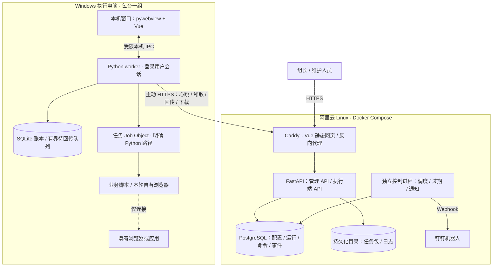
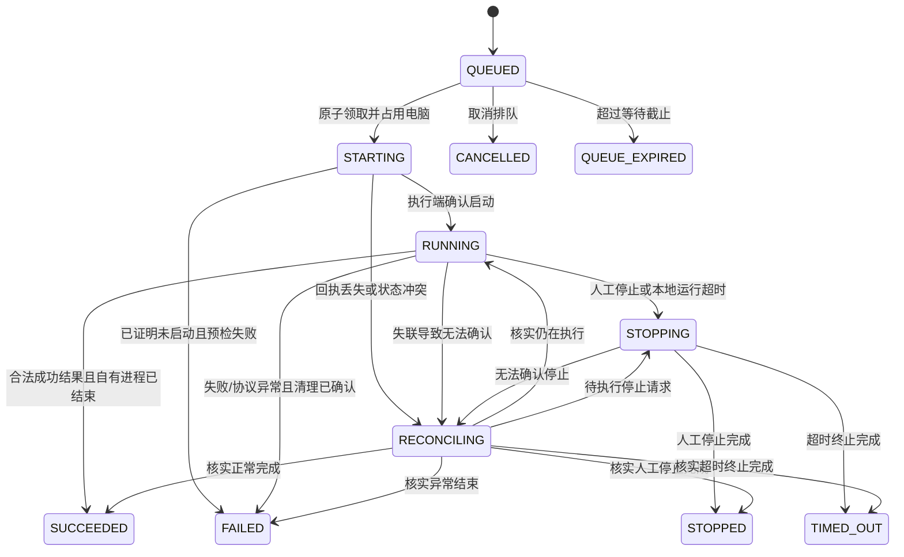
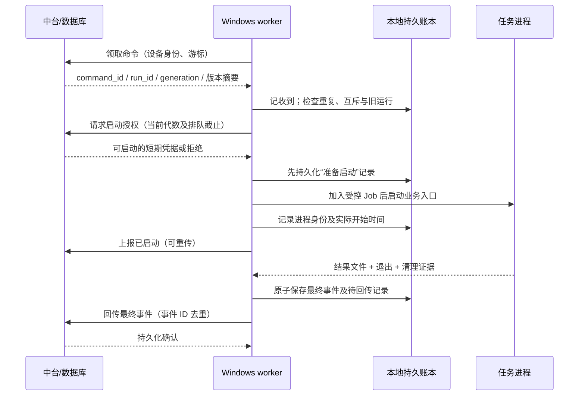

# autojobs 自动化脚本控制中台技术方案

版本：0.1；日期：2026-11-19；状态：目标技术方案，路线已获用户同意并开始 M0 本机实施。依据：[PRD v0.1](../product/automation-control-platform-prd.md)、[五张视觉原型](../product/prototypes/v0.1/README.md)、[脚本接入规范](../standards/script-integration.md)。用户已补充：后续主要使用 Python 和 Vue 开发维护。已实现边界与实际锁定版本以 [执行端说明](../../apps/agent/README.md) 和 [M0 交付记录](../delivery/2026-11-19-agent-m0/report.md) 为准；本文其余章节描述目标设计，不代表全部能力、兼容性或上线审批已完成。

## 1 推荐结论

**推荐：Vue 3 管理界面 + FastAPI 中台 + PostgreSQL + Python Windows 执行端，云端用 Docker Compose 部署。** 成熟开源组件负责接口、表单、数据库访问、环境安装和系统接口；我们实现本项目特有的设备串行队列、运行状态、环境检查、结果协议及钉钉通知。

这条路线保持团队主要使用 Python 与 Vue，能按现有原型做出直接服务组长和维护人员的界面。核心代价是：**可靠调度与 Windows 执行控制仍需要自己设计和测试**，不能因为用了几个高 Star 库就认为这些能力天然可靠。第一阶段先验证执行链路，随后再铺开页面。

| 层次 | 首选技术 | 本项目用途与边界 |
| --- | --- | --- |
| 管理网页 | Vue 3、TypeScript、Vite、Element Plus | 任务、电脑、环境、运行记录、通知配置；前端权限只控制展示 |
| API 服务 | Python 3.12 候选基线、FastAPI、Pydantic 2 | 登录、配置、上传、执行端协议、查询；不在请求进程中直接运行脚本 |
| 数据访问 | SQLAlchemy 2、Alembic、psycopg 3 | 事务、模式迁移与 PostgreSQL 访问；明确同步/异步边界 |
| 中台存储 | PostgreSQL 17 候选基线 | 计划、运行、设备占用、命令、事件及通知记录的唯一权威库 |
| 调度与通知 | 同一后端代码库的独立控制进程；APScheduler 3.x 仅计算计划时点 | 扫描数据库、生成运行、过期处理、发送通知；不使用另一套 job store 维护业务事实 |
| Windows 执行端 | 独立 Python worker、SQLite 本地账本、pywin32、psutil | 主动联网、单机互斥、环境检查、进程控制、离线缓存及核对 |
| 本机状态窗口 | pywebview + 本地打包的 Vue 页面 | 与 worker 分进程；关闭窗口不终止任务；IPC 首选受 ACL 保护的命名管道 |
| 任务环境 | uv + 指定 Python + 任务版本独立虚拟环境 | 检查不安装；用户点击后准备；已有外部环境默认只登记检查 |
| 浏览器 | 兼容现有 Playwright / Selenium 等脚本 | 不统一重写；按实际 OS、浏览器及驱动版本逐项验证 |
| 云端部署 | Docker Compose + Caddy + 持久化卷 | 单台 Linux 主机；暂不引入 Kubernetes、Redis、RabbitMQ |

上表为技术路线，**补丁版本、锁文件、镜像摘要、打包工具、托盘方案尚未冻结**。Python 3.12 指平台与执行端自身候选环境，不强迫业务脚本改用同一 Python。PostgreSQL 17 是保守候选，不是声称最新版本；版本支持以开发时官方矩阵复核。[PostgreSQL 支持版本](https://www.postgresql.org/support/versioning/)

## 2 决策依据：事实、约束与最难的问题

| 项目 | 依据及处理 |
| --- | --- |
| 真实目标 | 随时知道任务有没有跑、跑在哪里、结果如何，异常主动通知；不是建设通用低代码平台 |
| 当前规模 | 十几个脚本、两台专用 Windows 10、一人主要维护；先满足这个规模，不虚构吞吐指标 |
| 不可违反 | 固定电脑；整台电脑一次一个业务任务；缺环境先报告再由人准备；不静默补跑；停止须有实际证据 |
| 网络 | 执行机可上网；云端 Linux Docker。建议电脑主动发起 HTTPS，不要求云端入站连接办公室电脑 |
| 输入输出 | 固定文件与参数仍由脚本配置；每轮有结构化业务结果；步骤可选；成功通知默认关闭 |
| 维护条件 | 用户选择 Python、Vue；Codex 可协助开发测试，业务口径、账号权限和最终交付确认仍由项目负责人承担 |
| 未知事实 | OS edition/build、Python/浏览器清单、桌面自动化类型、是否有域名及现成网关、登录方式、数据保留期 |
| 最难验证 | 启动回执丢失时是否重复执行；Windows 桌面会话和强制停止；已连接应用的资源归属；重启后状态核对 |
| 回滚边界 | 文档可撤回；未来程序回滚不能撤销已经发出的业务接口写入，也不能自动把未知状态任务重新执行 |

## 3 GitHub 项目比较与复用方式

以下 Star 是 2026-11-19 的官方页面/API 快照，可能继续变化。完整抓取时间、许可证、维护字段及限流记录见 [平台调研](research/orchestrators-2026-11-19.md)、[组件调研](research/components-2026-11-19.md)、[Windows 专项](research/windows-agent-2026-11-19.md)。部分仓库未取得最近推送时间，不能据 Star 宣称维护活跃。本文对适配性与复杂度的判断是工程推断，尚未做成本或性能实测。

| 候选 | Star | 本项目如何使用 / 为什么不是主方案 |
| --- | ---: | --- |
| [FastAPI](https://github.com/fastapi/fastapi) | 104,890 | 推荐直接用接口框架，MIT |
| [Vue 3](https://github.com/vuejs/core) / [Element Plus](https://github.com/element-plus/element-plus) | 55,034 / 27,861 | 推荐直接用界面与控件，均 MIT |
| [uv](https://github.com/astral-sh/uv) | 92,360 | 推荐用环境准备工具，MIT / Apache-2.0；平台限制其自动下载行为 |
| [Vue Vben Admin](https://github.com/vbenjs/vue-vben-admin) | 33,830 | 参考导航与管理页结构，MIT；首期使用直接 Vue + Element Plus 工程，避免引入整套多包基座 |
| [Prefect](https://github.com/PrefectHQ/prefect) | 24,185 | **成品平台第一备选**，Apache-2.0；Windows process worker 有官方支持，仍要适配本机窗口、环境和故障语义 |
| [Windmill](https://github.com/windmill-labs/windmill) | 18,640 | 脚本管理能力接近；原生 Windows worker / HTTP Agent 有企业版边界，授权预算允许时验证整套使用 |
| [Airflow](https://github.com/apache/airflow) | 47,536 | 擅长 DAG 调度，生产平台侧以 Linux 为主；还需额外构建原生 Windows 桌面执行链路 |
| [Kestra](https://github.com/kestra-io/kestra) | 30,265 | 支持 Windows Process runner；固定 worker group 涉企业版，另增 JVM/流程插件维护 |
| [n8n](https://github.com/n8n-io/n8n) | 211,184 | 集成流程平台，SUL/企业授权；不是现成的本项目 Windows 执行端，不按宽松开源底座处理 |
| [Dagster](https://github.com/dagster-io/dagster) | 16,444 | 数据资产编排模型超过目前重点；将来关注数据血缘时重评 |
| [XXL-JOB](https://github.com/xuxueli/xxl-job) | 30,673 | 参考调度中心/执行器与日志设计；Java 引入成本、机器级互斥和当前 GPLv3 许可需考虑 |

关键事实已经核对：[Prefect 官方 Windows 说明](https://www.prefect.io/docs/v3/how-to-guides/self-hosted/server-windows)、[Windmill Microsoft 环境及版本边界](https://www.windmill.dev/docs/advanced/self_host/microsoft_environments)、[Kestra Worker Groups](https://kestra.io/docs/task-runners/task-runners-vs-worker-groups)、[XXL-JOB 当前 LICENSE](https://raw.githubusercontent.com/xuxueli/xxl-job/master/LICENSE)。XXL-JOB 同一任务的串行策略不能直接等同于整台电脑不同任务互斥，详见专项调研的源码依据。

不采用 Celery 作为 Windows 执行器：官方明确自 4.x 起不再支持 Windows。[Celery FAQ](https://docs.celeryq.dev/en/stable/faq.html)。APScheduler 4.x 文档仍有预发布警示，本方案使用经验证的 3.x 触发器计算，不共享 3.x job store。[版本说明](https://apscheduler.readthedocs.io/en/master/versionhistory.html)、[3.x 限制](https://apscheduler.readthedocs.io/en/3.x/faq.html)

**重新评估条件：**若执行端 POC 显示自研可靠性成本明显超出团队能力，用同一组故障用例对比 Prefect process worker，选择一个运行状态权威来源；不让两套平台同时调度同一脚本。若未来购买成品运维能力，则对比 Windmill 企业版；若未来主要是 DAG、数据资产或大量 Linux 容器任务，再重评其他平台。

## 4 总体架构与部署边界



- 云端首期四个常驻容器：`gateway`、`api`、`control`、`postgres`；前端静态文件由 gateway 提供，api/control 使用同一个后端构建产物的不同入口。它们是同一后端应用的不同进程，共享同一业务层，不另建有独立规则的调度服务。
- control 单实例；不把调度循环挂进每个 API worker。数据库唯一约束防重复计划实例，事务保护设备占用；重启不依赖内存恢复队列。
- 外部只暴露 HTTPS 管理入口；数据库不暴露公网。云端不运行上传的业务脚本，也不将 Docker socket 暴露给脚本。
- Windows 主动出站 HTTPS，初期采用带游标的短轮询及独立心跳；不依赖 WebSocket 保证命令交付。管理网页先用增量轮询，必要时再加 SSE。
- 单台云服务器是明确的单点。服务不可用期间不能生成或派发新任务；已运行任务由执行端本地监督。此次不承诺高可用、全年在线率或断网时仍能实时通知。

## 5 模块与目录建议

以下是下一阶段初始化的目标结构，本轮未创建业务模块。保持已有模板，只启用有实际职责的目录。

```text
apps/backend/                 同一 Python 后端应用
  src/autojobs/
    api/                      HTTP 协议、认证入口、参数校验
    services/                 任务、设备、运行、环境、通知业务
    persistence/              SQLAlchemy 模型、查询与事务
    control/                  计划扫描、派发、核对、通知发送循环
    integrations/             钉钉及存储适配
  migrations/                 Alembic 迁移
  tests/                      后端单元与数据库集成测试
apps/frontend/                中台 Vue 页面
apps/agent/                   拟新增，Windows 执行端
  worker/                     网络、本地账本、单轮执行与监督
  windows/                    进程 Job、会话、命名管道适配
  environment/                Python、依赖、浏览器检查和准备
  desktop/                    pywebview 宿主及本机 Vue 页面
  tests/                      可自动化逻辑及 Windows 集成测试
packages/protocol/            有两端调用后提取 JSON Schema/共享契约
packages/script-sdk/          协议冻结后提供最薄的结果写入工具
config/deploy/                后续 Compose 和非敏感配置示例
```

已有 `apps/jobs/` 保留预留状态，不用它再建设第二个调度器。只有实际出现独立批处理应用才启用。平台环境与任务环境分离；不通过安装业务脚本依赖改变 agent 自身依赖。

## 6 数据模型、时间与状态

### 6.1 核心记录

| 记录 | 关键内容 / 不变量 |
| --- | --- |
| `task` | 名称、固定电脑、启停、排队时限、运行时限、成功通知开关；不把任务条数与运行次数混为一谈 |
| `task_version` | 不可变版本、上传包摘要、入口、依赖与环境声明、发布状态；上传后不覆盖原包 |
| `schedule` | 计划、时区、启用状态、修订号、下一计划点；启停修改留审计 |
| `run` | 每轮唯一标识、触发来源、计划时点、排队截止、版本/电脑/环境快照、执行证据与终态原因 |
| `device` | 身份、最后有效心跳、会话能力、当前占用、执行代数；在线与占用分开 |
| `device_command` | 命令 ID、设备、run、代数、类型、有效期、确认及处理状态；持久化后才能发出 |
| `run_event` | 单轮递增序号/事件 ID、来源、观察时间、内容摘要；相同事件只入库一次 |
| `environment_binding` / `environment_operation` | 目标解释器、受管/外部维护、环境指纹、检查及准备记录；不是一个简单“已装 Python”布尔值 |
| `notification_channel` / `notification_event` / `notification_delivery` | 机器人配置、需通知的业务事件、每次发送尝试；任务结果与送达状态独立 |
| `user` / `audit_event` | 账号、角色和操作审计；具体权限矩阵待确认后冻结 |

建议约束：计划运行唯一键 `(schedule_id, scheduled_for_utc)`，避免修改计划后对同一时点重复创建；历史计划点不可变，修改只影响未来。手动运行带请求幂等键。设备只能有一个非空 `active_operation`（业务 run 或环境准备）；云端原子占用和本机互斥同时生效。

所有业务时间用 UTC 存储、带时区类型；界面及计划使用明确 IANA 时区，首期建议 `Asia/Shanghai`。计划修订、暂停与到点扫描在事务中裁决；执行时长使用本地单调计时，并处理休眠恢复时的截止检查。具体跨时区/DST不作为首期隐含承诺。

### 6.2 状态分层

- 任务：启用 / 暂停后续计划；不代表当前运行被停止。
- 设备连接：在线 / 失联；以最后心跳与可配置阈值判断。
- 设备占用：空闲 / 忙碌 / 维护中 / 待核实；断线不把占用自动改为空闲。
- 任务环境：未检查 / 就绪 / 缺项 / 准备中 / 准备失败；就绪有检查时间与指纹，不等于永久可运行。
- 运行：排队、启动中、运行中、停止中、待核实，以及成功、失败、排队超时、已取消、已停止、运行超时、漏跑等终态。



图为主要路径；重连证明从未启动时，可以结束为已取消/排队超时并释放占用，不能把它伪装成“运行失败”。每次状态修改使用预期状态/版本比较；迟到心跳不能把已确认终态改回运行中。停止请求与自然完成按本机事件顺序裁决：仅提交请求不等于已停止，先自然完成且未实际终止时保留自然结果。

## 7 调度、命令和失联：防止漏跑与重复运行

### 7.1 集中计划与机器队列

1. 控制进程按计划扫描，事务内生成单轮 run、不可变执行快照并推进下一计划点。跨进程重复扫描也受唯一键保护。
2. 建议同机按 `scheduled_for/requested_at`、创建序号排序；手动立即运行也入同一队列，没有隐含插队特权。FIFO、等待起点和默认值为待确认规则。
3. 领取前锁定设备记录，检查连接、占用、可执行会话、版本及环境状态，再把 run 改为 STARTING、占用设备并写入命令，一次提交。数据库锁仅保护短事务，不持续锁住整个业务运行。[PostgreSQL 行锁依据](https://www.postgresql.org/docs/current/explicit-locking.html)
4. 队列截止只取消可证明尚未获得启动授权的轮次。已进入 STARTING 又丢失回执时转待核实，发送撤销/停止请求；即使等待时间已过也不能直接释放设备。
5. 暂停只改变未来计划，已排队轮次按独立取消操作处理。失败不自动重跑。平台停机跨过计划点先记录漏跑，补跑规则未确认前不静默追回所有历史轮次。

### 7.2 从收到命令到真正启动

建议协议采用至少一次传输、幂等处理，**不承诺端到端业务恰好一次**。业务接口的写入幂等仍由脚本与目标系统实现。



本机启动存在“账本已记但尚未创建进程”与“已创建但回执未落盘”的崩溃窗口。恢复时必须核对本地记录、Job/进程身份及已保存结果，不能看到未完成记录就重新执行。无法证明未启动时保持待核实；宁可明确展示需处理，也不能冒险重复写业务数据。

启动凭据绑定设备、run、版本、代数和有效期；下发、领取和真正启动前都检查截止时间。过期命令不能启动。云端授予过启动权限后，即使凭据超时也不自动回收占用，因为进程可能已经开始。取消与授权竞争由事务决定：若取消先成功则拒绝授权；若授权先成功则取消进入停止/核对流程，界面不能显示“已取消排队”后让旧命令继续执行。

### 7.3 恢复与本地约束

- worker 通过跨会话可识别的机器级互斥与本地账本限制一个有效实例；锁权限与安装路径在 Windows POC 验证，不能仅靠内存变量。
- 心跳上报 `agent_instance_id`、本轮 `run_id`、执行代数、最后事件序号、进程/环境/会话摘要。心跳不作为结果；设备身份不能由客户端随意指定越权目标。
- 重连先核对旧 run，再恢复领取。重复命令回放原确认；旧代数命令拒绝；未知残留进程或设备与云端占用不一致时进入待核实。
- 断网：已运行任务继续接受本地超时监督；不启动新的缓存定时；结果与必要日志落盘，重连补传同一轮。缓存额度耗尽时拒绝新任务、报告明确故障，不丢弃未确认结果冒充成功。
- 租约、心跳超时只能发现异常，不能证明远端进程不存在。人工释放也须有本机进程清理和凭据/旧命令隔离证据；不得提供无条件“强制空闲后重跑”。
- 数据库恢复到较旧备份时先禁止派发，对两台电脑的运行账本与命令代数逐一核对并轮换派发 epoch，再恢复计划；不能仅恢复表后马上补跑。

## 8 Windows 执行端与本机页面

### 8.1 运行形态

首期推荐指定用户登录会话中的 Python worker，Windows 计划任务仅用于登录后启动/监督 agent，不再承载各业务脚本的时间计划。pywebview 状态窗口是独立进程，加载随安装包发布的本地页面，通过当前用户 ACL 的命名管道读取状态和提交有限诊断请求；不加载远端网页并开放任意 Python 桥。

微软明确服务位于 Session 0，不能把“安装成服务”当成可以操控用户桌面的保证。[Microsoft Interactive Services](https://learn.microsoft.com/en-us/windows/win32/services/interactive-services)。若用户未登录，首期中台应显示未就绪/失联，不能承诺重启后立即恢复桌面任务。未来可加系统监督服务，但用户会话执行与服务监督职责仍分开。

关闭窗口隐藏到托盘；即使 UI 整个进程退出，worker 仍运行。本机页主要显示连接、当前任务、日志摘要、环境和诊断；**不提供第二套调度或上传任务入口**。托盘先评估已需使用的 pywin32 原生能力；pystray 作为备选时单独核查 LGPL 许可与打包方式。pywebview/WebView2 依赖、打包工具和更新方式通过 POC 后冻结。[本机专项](research/windows-agent-2026-11-19.md)

### 8.2 启动与停止

- 任务启动必须使用已验证的 `python.exe` 绝对路径、参数数组、固定入口、独立工作目录及受控环境变量；不拼接网页提供的 shell 命令。
- 每轮建立 Windows Job Object；优先验证“挂起创建 → 加入 Job → 恢复执行”，避免子进程先逃离监督。worker 持有关键句柄，限制继承；进程身份记录 PID 加创建时间，不能只用 PID。
- 先通过合作取消标记给脚本清理机会；超出配置宽限期才强制结束本轮 Job。Windows 的 Python `terminate()`/`kill()` 不是一温和一强制，不能这样实现两阶段停止。[Python subprocess](https://docs.python.org/3.12/library/subprocess.html)
- Job Object 的 breakaway、嵌套 Job、浏览器进程策略必须实测；不能保证任何外部进程都被自动纳管。[Microsoft Job Objects](https://learn.microsoft.com/en-us/windows/win32/procthread/job-objects)
- 只结束本轮拥有的进程。连接已存在的浏览器、Excel 等应用，不等于取得结束它的权利；停止后若共享资源仍不确定，继续占用并待人工核对。
- 运行最长时限默认 24 小时，快照下发后由本地执行。超时先产生告警事件并进入停止中，确认自有进程结束后记运行超时；停不下来则保持待核实。云端可提醒，但不能代替本地监督。
- 强制停止不回滚业务接口写入；记录部分成功与人工核对提示。worker 崩溃时 Job 句柄清理作为防线，不能代替重启后的运行核对。

### 8.3 Windows 10 兼容门槛

当前 Playwright 官方支持列表为 Windows 11+、Windows Server 2019+ 或 WSL，不包含 Windows 10。微软 Windows 10 Home/Pro 常规支持已于 2025-10-14 结束，LTSC/ESU 应按实际版本单独核验。[Playwright 系统要求](https://playwright.dev/python/docs/intro#system-requirements)、[Windows 生命周期](https://learn.microsoft.com/en-us/lifecycle/products/windows-10-home-and-pro)

因此先盘点现有两台电脑和脚本依赖，保留已经现场验证的版本做兼容 POC；这不恢复上游支持，也不表示允许永久冻结旧组件。新部署优先评估 Windows 11，是否升级由用户另行决定。当前不自动更改操作系统、自动登录策略、锁屏策略或浏览器版本。

## 9 上传、版本、环境与登录态

### 9.1 任务包

建议上传 ZIP，包含固定入口、业务源码、依赖清单和声明文件；单个脚本也在中台整理为可追踪版本。包结构、字段名和限制在 Q07/Q11 冻结后生成正式 Schema。声明至少包括：任务入口、Python 约束、依赖文件、浏览器工具与组件需求、是否需要桌面、固定文件前置条件、应用资源所有权模式。它是环境声明，不是新增每轮临时传参界面。

上传后服务端流式计算 SHA-256，存入不可变版本目录；验证压缩文件路径穿越、Windows 绝对/UNC/驱动器路径、符号链接、重解析点、保留文件名、文件数、解压总量与压缩比。任务包校验不等于安全沙箱，脚本是经授权维护人员提供的代码。

执行端下载至 staging，校验摘要后解压并复检，成功再切换为“版本已分发”；下载失败保留旧版本。云端与本地文件落盘、数据库状态无法共用一个事务，采用 staging 状态、原子重命名和对账清理，不让数据库记录指向尚未完成的包。已有 run 固定版本和环境，上传新版本不改变在途任务。

### 9.2 环境自动化范围

| 对象 | 检查阶段 | 点击“一键准备”后 |
| --- | --- | --- |
| Python 本体 | 检测登记路径、实际版本/架构、能否启动 | 首期优先使用已安装解释器；自动下载本体另列可选安装项，未授权不执行 |
| 虚拟环境 | 区分受管与外部维护、基础解释器及指纹 | 用 uv 建新的任务版本环境，失败不影响旧环境 |
| Python 依赖 | 对照锁定清单及实际元数据，报告缺包/冲突 | 在新环境安装后复检；不原地升级共享环境 |
| Playwright 组件 | 对照脚本版本、浏览器二进制与实际 OS | 仅对已验证适配器下载匹配组件；不无条件升级包和浏览器 |
| Selenium | 驱动/浏览器路径版本和必要启动探测 | 根据已批准策略准备驱动，避免运行时隐式下载改变环境 |
| 固定文件与系统软件 | 检查声明路径、权限、Office/会话等专用条件 | 报告人工处理项；不承诺自动装任意软件、配置企业账号 |
| 登录态 | 可由脚本提供无副作用的业务登录检查 | 扫码/验证码/会话过期转人工恢复，不伪造“环境准备”可解决 |

检查流程禁用 uv 自动 Python 下载，使用精确路径；安装工具的自动行为必须受平台准备计划约束。[uv 环境选择](https://docs.astral.sh/uv/pip/environments/)、[uv Python 选择与下载](https://docs.astral.sh/uv/concepts/python-versions/)。依赖安装可能执行构建代码，因此沿用受信维护人员边界，包源为批准配置，凭据不写进任务包。

环境准备也占用设备维护槽，与业务任务互斥；受管环境在最终路径构建，完成后原子切换“活动环境引用”，**不移动已经创建的 venv 目录**，避免绝对路径失效。运行前再次做轻量检查，历史“就绪”不是跳过预检的理由。自动识别仅覆盖声明与可检测组件，不能通过扫描源码发现所有动态依赖。

环境准备使用独立 `operation_id`，复用第 7/8 节的命令去重、本地账本、受控进程和重启核对。安装/下载有独立可配置总时限和取消宽限，不默认套用业务任务 24 小时；超时或取消进入停止中，确认本轮安装及构建子进程已结束后才释放维护槽。worker 崩溃或电脑重启后先核对准备记录、残留进程及未完成环境，无法确认时保持待核实。失败环境不成为活动环境，旧环境继续保留；清理仅针对本轮受管路径。重新点击准备生成可追踪的新尝试，不能绕过旧操作仍占用设备的事实。

浏览器 profile 与任务包、虚拟环境、浏览器程序缓存分开存放，升级环境不删除登录资料。profile 默认留本机受限目录，不上传中台；共享 profile 必须独占并有所有权规则，不将生产 cookie 作为部署包内容。

## 10 脚本结果、日志与通信契约

### 10.1 本轮建议的脚本通道

保留既有规范中的字段，推荐**受控结果文件**作为首期脚本到执行端通道：执行端通过环境变量提供本轮 `run_id` 与唯一结果路径；脚本用临时文件写完再原子替换；stdout/stderr 仅用于日志，不用搜索一行文本判断成功。具体环境变量名、文件大小和 Schema 版本在 Q07 确认后冻结。

```json
{
  "protocol_version": "0.1",
  "run_id": "example-run-001",
  "status": "failed",
  "message": "登录状态失效，未完成本轮采集",
  "result": {"failed_step": "访问数据页面"},
  "error": {"code": "LOGIN_REQUIRED", "details": "需要人工恢复登录"}
}
```

这是建议示例，不是已执行结果或已存在的 SDK。`result` 保留任意合法 JSON 值，包括 null；禁 NaN/Infinity。run 不匹配、非法/缺结果、success 配非零退出码均不能判成功。业务 failed 即使退出码为 0 也仍失败。只有合法成功结果、正常退出和本轮自有进程清理全部成立才成功并释放设备。收到结果但进程仍活跃时继续计时。

本地账本事务保存最终事件与待回传记录；中台持久化确认后才回收缓存。相同事件重发只入库一次；内容冲突的相同事件不能直接覆盖。结构化业务结果与平台异常、停止原因分别保存，不把平台超时伪装成脚本返回值。

### 10.2 通信资源建议

以下是接口职责草案，路径与结构未发布，不要求现在创建空接口。

| 资源/操作 | 主要约束 |
| --- | --- |
| 任务、版本、计划、运行查询与四种人工控制 | 管理员/维护人员权限；写操作幂等及审计；分页与时间筛选 |
| 执行端一次性配对、凭据轮换和吊销 | 仅管理员签发短期配对凭据；设备凭据只访问自身资源 |
| 心跳、命令领取、启动授权、事件批次确认 | run/设备/版本/代数绑定；有限超时；幂等重传；协议版本兼容 |
| 任务包下载 | 设备绑定版本授权；摘要校验；不提供任意 URL 下载代理 |
| 环境检查/准备操作 | 检查与安装分开；准备计划绑定版本、电脑、环境指纹和操作者 |
| 日志增量查询、最终结果查询 | 分页/游标；脱敏、大小限制；不把任意本机路径暴露为下载接口 |
| 机器人管理、测试通知、通知记录 | Webhook 写入后遮罩；测试发消息须用户点击；接口返回成功不代表群成员已阅读 |

日志按序号分批、有界缓存；过长行截断有标记，磁盘配额与保留规则有告警。建议首期完整保存大小限额内的结构化结果，超限给明确协议错误；钉钉仅发脱敏摘要加受权限保护的详情链接，不静默丢弃失败返回值。任意结果文件附件上传/下载不列入首期已定功能。

## 11 通知中心与机器人配置

通知中心包含“通知记录”和“机器人配置”。配置字段建议为机器人名称、群说明、Webhook、安全方式及对应密钥/关键词、启停、任务关联、测试通知。平台保存密文，只显示遮罩，不回显完整链接；修改、测试、启停均留审计。钉钉自定义群 Webhook 机器人是官方说明中的一种机器人类别。[钉钉机器人概述](https://opensource.dingtalk.com/developerpedia/docs/learn/bot/overview/)

业务终态/异常事件与通知事件在同一数据库事务写入；发送进程从待发送表领取，记录每次结果和下次尝试时间。默认发送失败、排队超时、运行超时；设备失联与漏跑的通知策略在 Q05/Q12 确认。成功默认不发送，任务开启后才产生成功通知事件。

网络请求设置连接/读取总时限，区分可重试网络/限流错误和需改配置的认证错误，退避与总次数有上限。按官方协议同时检查 HTTP 状态及业务响应，不能仅 HTTP 200 就显示“发送成功”。实际加签、限流和消息长度须在接入时依据当前官方文档并用测试机器人验证；本轮未成功读取官方接入页正文，不把历史配额写死为最新规则。[官方接入入口](https://open.dingtalk.com/document/robots/custom-robot-access)

通知事件唯一键避免业务层重复生成；发送后响应丢失可能导致重发，外部 Webhook 不承诺绝对一次送达。中台使用“渠道已接受 / 失败 / 待重试”等准确状态，不显示“用户已读”。钉钉发送失败不修改任务结果，不再通过同一个坏渠道无限通知自己的失败。

Webhook 编辑入口会触发服务端出站请求，必须限制 HTTPS、批准的官方域名及路径、禁重定向和内网目标，防止配置变成任意地址请求工具。认证密钥与数据库分开管理，备份恢复必须同时恢复可用密钥但不能把密钥写入仓库。

## 12 账号、安全与运维

首期建议本地独立账号、管理员与维护人员两角色：管理员负责账号、执行端配对、机器人和系统配置；维护人员负责任务、计划、环境和运行控制。是否允许维护人员管理机器人、停止他人任务等属于 Q06，开发前确认。浏览器会话使用安全 Cookie、CSRF 防护、登录限速和会话撤销；不自创密码算法，不以路由隐藏代替后端鉴权。

Windows 设备凭据与人登录凭据分开，只准访问自己的命令、任务包和上报接口；本机限制凭据文件访问，优先评估 Windows 凭据保护能力。系统不提供任意远程终端功能。任务上传等于允许在执行机运行可信代码，执行机使用专用低权限账号，任务库不能被解释为多租户恶意代码隔离环境。

首期监控：最后心跳、队列最老等待、运行超时、待核实设备、调度扫描滞后、通知积压/失败、本机结果待回传量、磁盘与数据库容量、备份时间。对整台云服务器宕机的监控应放在云端系统外部，不能只依赖中台自己发钉钉；是否配置阿里云监控在部署阶段决定。

备份覆盖数据库、不可变任务包、必要日志和密钥恢复材料；恢复在隔离环境验证。数据库迁移只跑一次，先暂停派发并核对活跃任务，做兼容迁移再升级 API/control，最后逐台滚动升级 agent。禁止运行中替换任务环境或升级 agent。

回滚以旧镜像、旧 agent 安装包和兼容协议为基础；数据库模式优先增量兼容，不把破坏性 downgrade 当默认回滚。恢复旧库须执行第 7 节的账本核对。脚本版本可回退，但已发生的业务写入不能随程序回退，需要脚本自身幂等或人工处理。

## 13 页面与需求追踪

| 需求 | 原型/入口 | 设计位置 | 后续验收 |
| --- | --- | --- | --- |
| R01 | 总览、任务管理、运行记录 | 第 6/10 节，按任务与 run 分开统计 | AC01 |
| R02 | 任务上传/分发 | 第 9 节，不可变包、摘要和分发状态 | AC02、AC20 |
| R03 | 计划设置 | 第 6/7 节，单一调度来源 | AC03 |
| R04 | 队列、电脑详情 | 第 6/7/8 节，整机占用与本地互斥 | AC04 |
| R05 | 排队时限 | 第 7 节，未启动过期与启动待核实分离 | AC05 |
| R06 | 运行时限 | 第 8 节，本地 24 小时默认上限及停止确认 | AC06 |
| R07 | 立即运行/暂停/取消/停止 | 第 6/7/8 节，状态与竞争条件 | AC07、AC08、AC20 |
| R08 | 运行详情结果 | 第 10 节，业务结果和进程双证据 | AC09 |
| R09 | 可选步骤 | 第 10 节，事件/日志增量；无步骤也可运行 | AC10 |
| R10 | 通知中心及机器人维护 | 第 11 节，默认失败、成功开关和发送记录 | AC11、AC19 |
| R11 | Python 环境登记 | 第 9 节，明确解释器路径与版本 | AC12 |
| R12 | 浏览器组件检查 | 第 8/9 节，OS/驱动/组件与登录态边界 | AC13 |
| R13 | 检查后点击准备 | 第 9 节，维护槽、准备计划、失败不破坏旧环境 | AC13、AC14、AC20 |
| R14 | 依赖清单 | 第 9 节，锁定与实际解析指纹 | AC12、AC13 |
| R15 | 固定文件 | 第 9 节，声明前置条件；无临时传参流程 | AC15 |
| R16 | 失联/待核实 | 第 6/7 节，核对后才恢复派发 | AC16 |
| R17 | 漏跑及补跑差异 | 第 7/15 节，不统一自动补跑 | AC17 |
| R18 | 云端与本机窗口 | 第 4/8/12 节，登录、Docker及持久化 | AC18 |

原型中通知中心已有导航，但机器人表单尚没有独立效果图；正式 UI 必须补齐配置、校验、测试发送和发送失败交互。本机窗口是第五张原型；关闭/崩溃、失联、待核实、环境失败等仍需交互验收，静态图不代表这些功能已实现。

## 14 实施顺序与验收门禁

不按未经评估的周数承诺排期。每个阶段产出可运行的闭环和真实测试证据；阶段之间有依赖。下面都是**待执行**计划，未安装系统或运行用例。

| 阶段 | 工作包与产出 | 通过条件 / 失败处理 |
| --- | --- | --- |
| M0 执行路线 POC | 两台电脑盘点；选择纯 API/表格、自启浏览器、连接既有应用三类脱敏脚本；验证 worker/Job/窗口/环境 | Windows 专项 W01–W13；重点 W03/W05/W07/W08 不通过则先收窄支持范围或重评路线，不开始承诺无人值守 |
| M1 最小运行闭环 | 明确 Q06/Q07/Q08；账号和设备配对、单版本分发、手动 run、结构化结果、日志 | AC02、AC08、AC09、AC16、AC20；包括重复命令、回执丢失、越权、路径穿越和重启 |
| M2 集中调度与控制 | 明确 Q02/Q03/Q04；计划、队列、排队/运行超时、四种控制 | AC03–AC08、AC17；同机两种不同任务互斥，取消与派发竞争，重连不自动重跑 |
| M3 环境与维护 | 明确 Q01/Q09/Q11；环境登记、只读预检、一键准备、稳定本机状态窗口 | AC12–AC15；两个 Python、缺组件、安装失败/卡住、准备中取消/重启、任务运行中准备被排队/拒绝、UI关闭不中断 |
| M4 通知与完整页面 | 明确 Q05/Q10/Q12；通知记录/机器人配置、任务总览及全部原型交互 | AC01、AC10、AC11、AC19；失败业务值进入脱敏通知；成功开关；失败重试有上限 |
| M5 试点与恢复 | 全链路、故障演练、备份恢复、升级回滚及少量真实脚本试点 | AC01–AC20 全量回归；人工业务核对；先一个脚本一台电脑，再扩展 |

测试组合：pytest 做状态/协议与时间边界；真实临时 PostgreSQL 做事务、唯一约束与并发；Windows 隔离测试目录做实际进程树和会话测试；Vitest/Vue Test Utils 做表单组件；Playwright 在受支持测试系统验证中台页面；钉钉用可控 HTTP stub 测重试，再在授权测试群做真实验收。stub 不能替代本轮状态机、Windows 停止或最终真实渠道验收。

必须补的故障输入：重复/乱序事件、授权后断线、启动前后崩溃、结果丢失/非法/冲突、时钟偏差、休眠跨截止、磁盘满、数据库断连、包摘要错误、安装失败、通知响应丢失、备份恢复后旧命令重放。性能目标由盘点后的脚本日志量和实际时长确定，再制定负载；不以两台机器推导未经测试的最大容量。

迁移单个旧脚本时：清点并停用原常驻定时 → 确认旧进程结束 → 中台单次试跑 → 核对业务结果与无重复写入 → 再启用中台计划。回退前先暂停中台计划、取消队列并确认本轮结束，再恢复旧调度；两边不能同时启用。

## 15 待冻结的参数与决策

以下用于下一阶段具体评审，不阻止本轮交付技术建议，也不代表用户已经接受这些数值。已有明确默认只有运行时限 24 小时和成功通知关闭。

| 对应 PRD | 技术建议/待决定内容 | 冻结点 |
| --- | --- | --- |
| Q01 | 首期受管 venv/依赖/已验证浏览器适配器；Python 本体安装另列可选项；准备总时限/取消宽限独立配置 | M0/M3 |
| Q02 | 等待时限必填；计划从计划时点、手动从提交时点计；FIFO；STARTING 不直接按排队过期释放 | M2 |
| Q03 | 停机错过时点记录漏跑，首期不自动补跑；手动重跑不能冒充按历史业务日期补数 | M2 |
| Q04 | 首期每日多时间点、Asia/Shanghai；周/月/Cron 高级表达式后评估 | M2 |
| Q05 | 建议心跳 15 秒、失联阈值 60 秒、命令轮询 3 秒；按试点网络调整。通知重试次数/间隔另配并有上限 | M2/M4 |
| Q06 | 本地独立账号，两角色；维护人员机器人权限、设备配对与凭据轮换 | M1 |
| Q07 | 受控 JSON 结果文件、序号事件与协议 0.1；Schema、大小和错误码正式冻结 | M1 |
| Q08 | Job 管理自有进程；合作停止宽限建议 10 秒；已有应用归属逐脚本声明 | M0/M1 |
| Q09 | 实际 Win10 edition/build、浏览器版本、锁屏/RDP/注销行为；升级 Windows 11 的安排 | M0 |
| Q10 | 建议日志 30 天、运行摘要 180 天作容量试算输入；正式保留期、结果上限、备份目标待业务决定 | M4 |
| Q11 | ZIP + 声明 + 依赖清单；包大小/文件数/解压额度/版本保留先按脚本盘点确定 | M1/M3 |
| Q12 | 失败/两类超时必需；失联、漏跑、环境准备失败、停止失败的合并告警规则；成功内容默认不启用 | M4 |

这些阈值是可配置建议，不是当前运行结果或服务承诺。时间目标、数据容量、许可证清单、版本锁定、完整权限矩阵和故障测试证据齐备后，才进入后续发布门禁。

## 16 本文验证状态

官方仓库和文档已调研，方案的事实、推断及未验证项已区分。技术选择记录见 [ADR-0001](../decisions/0001-control-platform-stack.md)；本轮实际检查与独立复核见 [交付记录](../delivery/2026-11-19-architecture/report.md)。本文中的数据模型、协议、模块、状态机与测试场景均是设计，尚无业务实现。

Codex 自检通过不等于开发自测确认、人工代码评审、CI 验证或发布审批通过。
