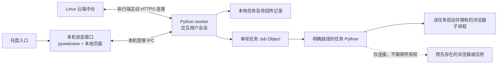

# Windows 执行端技术路线专项调研

调研日期：2026-11-19。性质：技术选择建议，未实施执行端、未安装依赖、未运行用户任务。本报告依据现有 PRD、脚本接入草案和官方资料，不替代实机兼容性验收。

## 1 结论与决策边界

建议第一版采用 **Python 常驻 worker + 独立本机状态窗口 + 每任务独立 Python 环境**。worker 在指定 Windows 用户的交互会话中运行，主动连接云端领取任务，负责心跳、串行执行、环境检查、结果缓存与回传、本地超时。窗口采用 **pywebview + 本地打包的 Web 页面**作为首选，托盘组件另行选型；窗口关闭或崩溃不应影响 worker。以上是基于当前“两台电脑、十几个脚本、主要一人维护”的工程判断，不是已实现能力。

- 直接复用 uv 管理新建虚拟环境和安装已锁定依赖；保留指定已有解释器/虚拟环境的兼容接入方式。
- 复用 psutil 获取进程和系统诊断；Windows Job Objects 是受控进程树终止的核心，不能用“按进程名称全部结束”代替。
- 保留已有 Playwright、Selenium 和其他脚本入口，不强迫统一重写浏览器代码；标准化任务声明、单次入口、最终结果和清理责任。
- 不把桌面浏览器任务直接交给 Session 0 Windows 服务。第一版可在指定用户登录后通过 Windows 计划任务启动 worker；这是拟议启动方式，安装权限、恢复策略、锁屏及远程桌面行为必须验证。
- 当前 Playwright 官方安装页列的是 Windows 11+、Windows Server 2019+ 或 WSL，**不能声称当前最新版官方支持现有 Windows 10**。新环境优先评估 Windows 11；现有 Windows 10 按已验证版本过渡，升级需另行决策。[Playwright 系统要求](https://playwright.dev/python/docs/intro#system-requirements)

最先应做的验证不是完整中台，而是“一台真实执行电脑上，已有代表性脚本能启动、能结束、能停止、断线不重跑、窗口关闭不中断”的短链路 POC。

## 2 已确认事实与未确认项

| 类别 | 内容 |
| --- | --- |
| 产品事实 | 两台专用 Windows 10 电脑；任务固定绑定电脑；同机一次只能执行一个任务；浏览器登录状态已有保留方式 |
| 产品事实 | 既有脚本可能启动自己的浏览器，也可能连接已有应用；中台上传分发；运行前检查；人触发环境准备 |
| 产品事实 | 最长运行时间默认 24 小时；允许停止运行；失败经中台发钉钉；步骤上报可选 |
| 尚未核验 | Windows 10 具体 edition/build、是否 LTSC/ESU、CPU 架构、登录用户/权限和实际会话方式 |
| 尚未核验 | 现有 Python、Playwright/Selenium、浏览器/驱动具体版本；浏览器 profile 位置；依赖源码编译或系统组件情况 |
| 待实现时冻结 | 本机 IPC、安装包、worker 进程监督、任务资源所有权声明、自动安装清单、重启恢复协议 |

## 3 后台 worker 与状态窗口

worker 的生命周期必须独立于窗口。窗口负责显示连接状态、当前任务、环境检查结果、日志摘要和诊断入口；不能自行再调度任务。关闭窗口隐藏到托盘与 worker 继续运行是两个不同保证：即使整个 UI 进程退出，worker 仍应存活。显式“退出执行端”需要先停止接单，展示当前任务处置，再结束 worker；具体交互待产品确认。

pywebview 文档说明 GUI 主循环会阻塞调用线程，后台逻辑需放到线程或进程。本项目选择分进程，是为了满足 UI 故障不干扰执行的需求，不能仅靠把脚本塞进一个 UI 线程来实现。[pywebview 使用说明](https://pywebview.flowrl.com/guide/usage.html)

本机 IPC 建议优先评估带当前用户 ACL 的命名管道；若采用 loopback HTTP，须限制监听回环地址、校验本机会话凭证和来源、避免任意网页调用危险 API。只向 UI 暴露必要操作，禁止暴露任意命令执行、任意文件读取和通用 Python 调用。UI 加载随安装包发布的可信静态页面，不用远端网页控制本机 Python 桥。pywebview 官方专门提示了本地 REST API 的 CSRF 风险，框架 token 也不能代替所有接口权限校验。[pywebview 安全说明](https://pywebview.flowrl.com/guide/security.html)

### 3.1 窗口方案比较

| 方案 | 可复用能力 | 本项目代价/边界 | 建议 |
| --- | --- | --- | --- |
| pywebview | Python 与 Web UI 桥接；可沿用中台页面技术；Windows 使用 WebView2 等渲染器 | 需要验证 WebView2、pythonnet/.NET、打包和 GUI 主循环；托盘需组合组件 | 首选，先验证打包和窗口生命周期 |
| PySide6 | Qt 原生窗口、信号槽、QSystemTrayIcon 托盘 | 新增 Qt UI 体系；许可证和打包依赖需逐项核查；不能因是 Python 就忽略桌面 UI 学习成本 | 若团队偏原生小工具，可选 |
| Tauri 2 | Web UI、系统托盘、安装器等桌面基础能力 | 引入 Rust/Windows 构建工具链；Python worker 仍需要另行管理、分发和升级 | 暂不首选，未来桌面产品复杂化再评估 |

依据：[pywebview Windows 依赖](https://pywebview.flowrl.com/guide/installation.html)、[Qt 托盘 API](https://doc.qt.io/qtforpython-6/PySide6/QtWidgets/QSystemTrayIcon.html)、[Qt for Python 许可证](https://doc.qt.io/qtforpython-6/licenses.html)、[Tauri 开发先决条件](https://v2.tauri.app/start/prerequisites/)、[Tauri 托盘](https://v2.tauri.app/learn/system-tray/)。表中的“代价”和“首选”是结合团队情况的判断，未测量包体积、内存或性能。

pystray 可作为托盘候选：官方文档允许 Windows 下在非主线程运行其循环。但它不属于高 Star 项目，许可证为 LGPL-3.0，不能未经许可证和打包方式核查就当作无成本默认依赖。也可以通过现有 pywin32 能力实现小范围原生托盘；该选择需在 UI POC 后确定。[pystray 用法](https://pystray.readthedocs.io/en/latest/usage.html)

## 4 Windows 交互会话限制

微软明确说明服务从 Windows Vista 起不能直接与用户交互，服务运行在 Session 0；服务需要与用户界面交互时，应把用户会话中的 GUI 与服务通过 IPC 分开。因此“装成 Windows 服务就能一直操作当前用户浏览器”不是可靠承诺。[Microsoft Interactive Services](https://learn.microsoft.com/en-us/windows/win32/services/interactive-services)

本项目的推导是：第一版先把执行器放在专用用户的登录会话，按任务类别声明是否需要桌面；未来如需开机即在线，可增加只负责联网/监督的系统服务，再由用户会话执行器承接桌面任务，不能把这两层混为一体。

状态至少分开报告：

- `connection`：中台最近是否收到有效心跳。
- `execution_slot`：本机执行槽是否被一个 run 占用。
- `readiness`：该任务需要的解释器、依赖、文件、浏览器、会话是否满足。
- `session`：观察到的登录/会话状态，以及此检查能覆盖和不能覆盖的能力。

“在线”不等于“空闲”，更不等于“任何任务可执行”。登录后锁屏、RDP 断开、用户注销、电脑休眠、切换用户、浏览器 headless/headed、桌面鼠标键盘模拟的结果都可能不同。官方 Session 0 文档不能替代这些组合的实机验证，不应统一标为支持或不支持。不能为便利自动关闭系统安全策略或存储明文自动登录密码。

## 5 子进程、停止与断线超时

### 5.1 执行边界

每轮任务必须使用确定的 `python.exe` 绝对路径、独立工作目录、受控环境变量、参数数组，并记录实际版本、任务包摘要和环境摘要。生产入口应为固定的 Python 文件/模块，不接受网页提交任意 shell 命令。Python 官方支持通过 subprocess 管理标准输入输出与退出码；Windows 上 `terminate()` 调用 `TerminateProcess()`，`kill()` 是同义操作，不能把二者误写成“先温和停止、再强制停止”。[Python 3.12 subprocess](https://docs.python.org/3.12/library/subprocess.html)

优雅停止应是脚本合作协议，例如 SDK 检查取消标记并清理资源；不合作或超时后才进入受控强制终止。强制终止不能保证业务事务已回滚，不能保证写入接口没有部分成功；结果应明确停止原因及需人工核对的业务副作用。

### 5.2 Windows Job Objects

Job Object 能管理一组进程，默认规则下子进程可跟随加入，支持整体终止及 `JOB_OBJECT_LIMIT_KILL_ON_JOB_CLOSE`。但存在 breakaway 和其他进程创建路径的例外，嵌套 Job 和浏览器自身进程管理也需验证，不能承诺任意脚本创建的任何进程都必然被捕获。[Microsoft Job Objects](https://learn.microsoft.com/en-us/windows/win32/procthread/job-objects)

建议实现约束：

1. 每轮创建独立 Job，启动进程在运行用户代码前即进入 Job，避免“先启动再登记”期间产生未受控子进程。可评估挂起创建、加入 Job、恢复执行的 Win32 路径，是否采用该路径由 POC 验证后冻结。
2. worker 持有 Job 生命周期，UI 不持有关键 Job 句柄；禁止错误继承句柄令最后句柄关闭条件失效。
3. 仅终止本轮拥有的进程；不按 `chrome.exe`、`python.exe` 等全局进程名杀进程。
4. 任务连接既有浏览器/Excel/其他程序时，它们不自动成为本轮所有资源。停止脚本后只断开连接；若无法证明资源已安全释放，执行槽保持需检查状态，不能立刻派下一轮。
5. psutil 用于资源采样、进程诊断与已知进程核对；采样不能替代 Job 的生命周期约束，PID 也不能单独作为长期唯一身份。

psutil 官方说明其支持 Windows 上的系统/进程指标及进程管理。[psutil 文档](https://psutil.readthedocs.io/stable/)

### 5.3 离线仍受约束

拟议行为：运行开始时执行端获得不可变的本轮最长时限，落盘本轮身份与开始记录；活跃期间用本地单调计时控制超时，不依赖云端再发停止消息。断网时正在运行的任务继续受本地时限约束，结果和日志有限缓存；恢复网络后重传同一结果而非重跑。

暂停/停止消息需要明确“中台已接受”和“执行端已确认”两个阶段。电脑离线时不能承诺已停止。中台失联只标记执行状态待核对，不自动释放槽或重派；重新连接后核对 `run_id`、实际进程和最终结果。worker 崩溃、电脑重启、休眠跨过截止时间的处理需 POC，不能仅凭本地时间字段宣称恢复可靠。

## 6 环境检查与准备

uv 官方支持创建 venv、选择 Python 版本或明确路径，以及向指定环境安装依赖；它默认还可能自动下载缺失 Python。这使其适合复用，但需由平台约束行为。[uv Python 环境](https://docs.astral.sh/uv/pip/environments/)、[uv Python 版本](https://docs.astral.sh/uv/concepts/python-versions/)

建议流程：上传并验证声明 → 选择电脑及解释器 → 只读检查缺项 → 显示准备计划 → 人触发准备 → 新环境构建/校验 → 切换为就绪 → 单次试跑。调度触发时不偷偷安装或升级。

| 检查对象 | 能可靠确认什么 | 不能据此承诺什么 |
| --- | --- | --- |
| Python | 确定路径、实际版本、架构、可执行性 | 系统里存在某个 Python 就能运行所有任务 |
| 虚拟环境 | 所属解释器、依赖元数据、锁定版本差异 | `import` 成功就表示业务及本地动态库全部兼容 |
| 浏览器 | 声明的引擎/可执行文件/驱动、版本及有限启动探测 | 有浏览器就能复用登录态，或登录态永不过期 |
| 文件/目录 | 声明路径存在、权限及有限读写探测 | 扫描源代码即可发现所有动态路径和外部依赖 |
| 账号/系统组件 | 可声明并运行专门的无副作用检查 | 自动解决扫码/验证码、Office 激活或任意系统软件安装 |

建议把环境分成两类：worker 自身固定运行环境；每个任务版本的业务环境。已有外部维护的 venv 默认只登记和检查，安装到新建受管 venv 后再切换。不得对正在运行或其他任务共享的环境原地升级。新任务使用精确依赖锁定；历史 `requirements.txt` 可接入，但范围版本需生成并记录实际解析结果，不能宣称完全可复现。

在自动执行路径设置 uv 的 `--no-python-downloads` 或受控 `python-downloads` 配置，避免检查变成静默安装。是否允许人工准备时下载 Python 本体需纳入安装清单；安装库还可能触发构建步骤或系统依赖要求，不能承诺“有网就全部装好”。该限制是本项目建议，不是 uv 默认行为。

## 7 浏览器兼容与登录态

Playwright 每个版本匹配特定浏览器二进制，升级 Python 包可能需要重新安装匹配浏览器；只检查 pip 包不完整。[Playwright 浏览器管理](https://playwright.dev/python/docs/browsers)

Selenium Manager 提供浏览器与驱动自动管理，适合复用，但首次启动的下载、代理和版本匹配可能产生隐式环境变更。因此建议把准备阶段和试跑前检查显式化；保留脚本明确指定既有驱动的兼容路径，不在每次生产运行前无条件更新。[Selenium Manager](https://www.selenium.dev/documentation/selenium_manager/)

执行端标准化的是进程与结果协议，不替换脚本自动化框架。受管浏览器 profile 应按电脑与任务稳定存放，升级环境不删除登录资料；缓存浏览器、已登录 profile、下载目录应分开管理。共享 profile 的锁、脚本连接既有浏览器的方式以及清理边界仍须逐脚本确认。登录态保留不能消除过期、扫码和验证码，过期应返回明确失败与人工处理入口。

## 8 Windows 10 生命周期

微软记录 Windows 10 Home/Pro 的常规支持结束日期为 2025-10-14，同时明确 LTSC 按自己的生命周期继续。因此本项目调研日不能笼统把全部 Windows 10 都判定为同一支持状态，必须采集实际 edition/build 与延长支持情况。[Windows 10 Home and Pro 生命周期](https://learn.microsoft.com/en-us/lifecycle/products/windows-10-home-and-pro)

本项目建议新电脑优先验证 Windows 11；现有两台机器先做软件清单和兼容试跑，再决定升级或受控过渡。冻结已验证版本只降低变化风险，不会恢复上游支持，也不代表可无限期停留旧版本。本次没有改变用户操作系统、浏览器或依赖。

## 9 开源项目快照与复用建议

快照抓取时间：2026-11-19 09:38:40–09:38:44 UTC（北京时间 17:38）。精确 Star 来自官方 GitHub 仓库 HTML 内嵌 `stargazerCount`，非页面四舍五入数字。匿名 GitHub REST API 返回 403 速率限制，因此未取得 API `pushed_at`；所有项目该字段保留 `null`，不以页面更新时间代替。完整机器可读记录见 [windows-github-snapshot.json](windows-github-snapshot.json)。

| 官方仓库 | 精确 Star | 已归档 | 许可证核验 | 采用方式 |
| --- | ---: | --- | --- | --- |
| [r0x0r/pywebview](https://github.com/r0x0r/pywebview) | 6,173 | 否 | BSD-3-Clause | 本机状态窗口首选候选 |
| [astral-sh/uv](https://github.com/astral-sh/uv) | 92,360 | 否 | MIT / Apache-2.0，项目提供两份许可证 | 环境创建、解释器选择、安装/锁定依赖 |
| [giampaolo/psutil](https://github.com/giampaolo/psutil) | 11,326 | 否 | BSD-3-Clause | 资源和进程诊断 |
| [mhammond/pywin32](https://github.com/mhammond/pywin32) | 5,638 | 否 | 混合许可证，按源文件与发布包许可证核查，不能简写为 MIT/PSF | Windows Job/会话/命名管道等系统接口候选 |
| [microsoft/playwright-python](https://github.com/microsoft/playwright-python) | 15,119 | 否 | Apache-2.0 | 兼容已有脚本；新脚本选择需匹配 OS 支持 |
| [SeleniumHQ/selenium](https://github.com/SeleniumHQ/selenium) | 34,598 | 否 | Apache-2.0 | 保留既有脚本和驱动管理方式 |
| [tauri-apps/tauri](https://github.com/tauri-apps/tauri) | 112,977 | 否 | 按模块 MIT 或 MIT/Apache-2.0；Logo 另有许可 | 桌面 UI 备选，不因 Star 高直接引入 |
| [moses-palmer/pystray](https://github.com/moses-palmer/pystray) | 575 | 否 | LGPL-3.0 | 托盘备选，需单独核查分发方式 |

归档状态同样来自仓库 HTML 内嵌数据。Star 只反映关注度，不能证明安全、兼容、维护资源或本项目适配。pywin32 官方还提醒版本号递增可能含破坏性变化，建议锁定版本。[pywin32 版本与许可说明](https://github.com/mhammond/pywin32#licenses)

本次仅检查仓库与官方文档，没有审查所有源码或传递依赖；许可证记录是选型信息，最终发布前需按实际锁定版本及打包内容生成第三方清单。

## 10 第一轮 POC 与验收证据

以下均为**待执行**，没有兼容性通过结论。应在脱敏测试任务和非生产目录中执行；业务接口使用无副作用测试目标。

| 用例 | 场景与输入 | 预期/证据 |
| --- | --- | --- |
| W01 | 两台电脑分别采集 edition/build、架构、Python/浏览器/驱动版本 | 输出可复核清单；区分厂商支持与现场可用性 |
| W02 | UI 关闭、UI 崩溃、重新打开窗口 | worker 与正在运行的测试任务不受影响；重开看到真实状态 |
| W03 | 登录、锁屏、RDP 断开、注销、重启分别试代表性任务 | 按任务类别记录成功/失败及日志；无法执行时不显示“就绪” |
| W04 | worker/任务同时启动多次、重复 run 命令、ACK 丢失 | 单机只有一个有效执行槽，同一 run 只启动一次；保留去重记录 |
| W05 | Python 再启动子 Python 和拥有的浏览器，手动停止/到时限 | 仅本轮进程被停止；清理确认后释放槽；实际 PID/创建时间/Job 证据可追溯 |
| W06 | 脚本连接预先存在的浏览器/应用后停止 | 不误杀共享程序；无法证明清理完成时转需检查状态 |
| W07 | 运行中断网、云端重启、结果 ACK 丢失 | 本地时限仍生效；结果有限缓存、重传去重；不自动重跑 |
| W08 | worker 被终止、电脑重启、休眠跨越超时 | 检查 Job 清理与残留；恢复核对旧 run；不在状态未知时启动新任务 |
| W09 | 同机两版 Python、不同包版本、解释器被删除、路径含中文空格 | 精确识别目标环境；不使用 PATH 中另一解释器兜底 |
| W10 | uv 准备失败、网络失败、包构建失败、准备时任务正在运行 | 当前可用环境不受影响；新环境失败可清理/重试；不给就绪标记 |
| W11 | Playwright 缺浏览器、Selenium 驱动不匹配、登录态过期 | 能区分依赖缺失、启动失败和需登录；不误报成功 |
| W12 | 无 WebView2、打包安装、普通用户权限、托盘循环 | 给出明确诊断；关闭行为稳定；确认发布包第三方许可证 |
| W13 | 本机非授权用户/网页访问 IPC，非法命令/路径、过大日志 | 拒绝越权与任意执行；日志有界、无凭据泄露 |

POC 产出应包含实际版本、测试电脑/会话条件、执行步骤、日志、退出码、通过/失败/未执行数量及风险说明。未通过 W03/W05/W07/W08 时，不应把桌面任务的无人值守与可靠停止列为已验证能力。

## 11 本次验证记录

- 只读核验了 PRD 和脚本接入草案；当前根目录未初始化 Git，无法提供分支/提交基线。
- 本次执行官方网页与 GitHub HTML 读取，未运行浏览器、脚本、环境安装或电脑控制。
- GitHub REST API 采集失败：HTTP 403，匿名额度已用尽；随后成功读取 8 个官方仓库 HTML，记录精确 Star、归档标志和许可证信息。
- JSON 文件完成解析和必要字段检查；Markdown 内部相对链接检查由主任务统一执行。
- 业务编译、单测、API、UI、性能、兼容、安全和故障测试均未执行，因为本次只交付选型研究，不包含可运行执行端。
- 本文为研究建议，不表示人工评审、CI 或发布批准通过。Codex 自检通过不等于开发自测确认、人工代码评审、CI 验证或发布审批通过。
