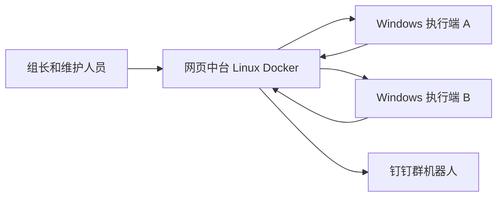

# 自动化脚本控制中台产品需求文档

版本：0.1。日期：2026-11-19。状态：产品评审草案。产品暂沿用项目名 `autojobs`。

配套查看：[主要页面视觉原型及本地执行端](prototypes/v0.1/README.md)。图片使用演示数据，用于评审布局与操作入口；不改变本文已确认规则和待决事项。

面向企业自动化团队，将分散在执行电脑上的脚本纳入统一管理：在中台上传任务、配置执行时间、检查和准备环境，查看是否按时执行及执行结果，异常通过钉钉群通知负责人。第一版服务于现有十几个脚本、两台专用执行电脑和组长、维护人员的日常管理。

本文区分**已确认需求**与**建议设计**。已确认需求来自本次产品访谈；建议设计用于使需求可实现、可验收，尚未冻结为技术方案。当前项目仍处于产品设计阶段。

## 1 背景与目标

### 1.1 当前工作方式

自动化组已从传统 RPA 扩展到自行编写 Python 等自动化脚本。典型任务涉及网页登录和数据抓取、调用接口、读取和处理表格，再通过接口将数据送入数仓；其他任务也可能有不同的业务输出，不能统一用“数仓写入成功”定义任务成功。

当前约有十几个脚本，由一名人员主要维护，运行在两台专用 Windows 10 电脑上。多数每天一次，部分每天两三次。脚本各自包含定时循环，需要长期保持运行。发生电脑断网、任务没跑等问题时，负责人无法及时发现，只能事后逐层追查。

任务通常固定在一台电脑上运行，一台电脑不能同时执行多个任务。浏览器通常由脚本启动，部分脚本连接电脑上已有的应用；网页登录主要依赖保留的登录状态，通常持续一两个月。扫码、验证码的自动处理尚未解决。

### 1.2 第一版要达到的结果

1. 负责人能从一个入口知道有多少任务、计划何时执行、是否实际执行、执行电脑及最后结果。
2. 任务在指定电脑串行执行，排队和运行都有明确的时间限制及异常处理。
3. 任务因运行环境不满足而无法执行时，中台能报告缺项，并提供由人触发的环境准备入口。
4. 脚本按统一约定上报业务结果；失败和重要运行异常能够在中台追踪并发送到钉钉。
5. 脚本上传、分发和计划配置集中到中台，减少逐台电脑维护的工作。

产品上线后关注按计划执行情况、漏跑发现情况、异常通知送达情况及人工追查成本。本轮未约定改善百分比、吞吐量或故障恢复时间，不作为已经承诺的指标。

## 2 用户与部署条件

| 项目 | 已确认情况 |
| --- | --- |
| 主要用户 | 自动化组组长、脚本维护人员 |
| 中台位置 | 阿里云 Linux 云服务器，使用 Docker 部署 |
| 执行位置 | 两台专用 Windows 10 电脑，可直接联网下载组件 |
| 任务关系 | 每个任务固定绑定一台电脑，同机串行；不要求自动迁移到另一台 |
| 通知渠道 | 钉钉群机器人，通过 Webhook 发送 |
| 脚本交付 | 希望在中台上传脚本，再分发到指定电脑 |
| 环境特点 | 同机可能有多个 Python 版本和虚拟环境，包依赖各不相同；还涉及浏览器自动化 |

**建议设计：**组长和维护人员使用网页中台；执行电脑安装执行端，负责接收任务、环境检查与准备、启动和停止进程、回传状态。执行端可有简单状态窗口，展示连接及执行情况，不另建一套任务管理界面。执行端形态、通信方式、账号权限差异见第 12 节待决事项。

图表示职责与信息流，不规定网络连接由哪一端发起，也不表示已实现远程桌面操作。

## 3 已确认的需求清单

| 编号 | 需求 | 确认口径 |
| --- | --- | --- |
| R01 | 任务总览与运行记录 | 看得到任务数量、当前执行情况、是否按计划运行及执行结果 |
| R02 | 任务上传和分发 | 中台上传脚本，发到指定执行电脑 |
| R03 | 统一定时配置 | 在中台设置任务时间，接管现有脚本内部分散的定时方式 |
| R04 | 固定电脑串行与排队 | 同机一次一个任务，到点忙碌则排队 |
| R05 | 排队超时 | 每任务可设置最多等待多久，超时取消本轮并通知 |
| R06 | 运行超时 | 每任务可设置最长运行时间，默认 24 小时；超时终止本轮并通知 |
| R07 | 人工控制 | 立即运行、暂停后续定时计划、取消排队、停止正在运行的任务 |
| R08 | 统一脚本结果约定 | 脚本决定业务成功/失败，返回值被中台接收；纳入脚本编写规范 |
| R09 | 可选步骤进度 | 基本执行状态必需；脚本步骤上报可选，一般不需要百分比进度 |
| R10 | 失败告警与成功开关 | 失败返回内容可传至钉钉；成功通知默认关闭，可按任务开启 |
| R11 | Python 环境识别 | 指定具体 Python/虚拟环境，识别缺失依赖和版本问题 |
| R12 | 浏览器环境识别 | 纳入浏览器自动化所需环境检查；具体工具清单需盘点 |
| R13 | 一键准备环境 | 检查后展示缺项，由人点击准备；执行电脑可联网 |
| R14 | 依赖清单 | 脚本维护人员可以为任务提供依赖清单 |
| R15 | 固定输入配置 | 文件路径及固定参数由脚本维护，第一版不要求临时传参和文件上传输入 |
| R16 | 失联及漏跑可见 | 解决电脑断网、任务未跑却不能及时发现的问题 |
| R17 | 补跑差异 | 有些任务需补跑，有些实时数据任务错过后补跑无意义，不能统一自动补跑 |
| R18 | 目标部署及用户 | 两类内部用户、云端 Linux Docker、两台专用 Windows 10 执行机 |

以下功能细化以此清单为基础。未由用户指定的默认数值、协议字段和异常恢复方式均作为建议，不反向改写确认口径。

## 4 第一版范围

### 4.1 必须覆盖

任务台账、脚本上传及分发结果、绑定电脑、集中定时、同机串行队列、排队与运行超时、四种人工控制、运行环境登记及缺项检查、点击触发环境准备、结构化结果、执行历史、电脑在线状态、钉钉告警及发送记录。

### 4.2 保留但不强制使用

脚本上报当前步骤；按任务开启成功通知。脚本不实现步骤上报，也必须能正常接入、执行并返回最终结果。

### 4.3 暂不纳入首期目标

以下为根据访谈形成的首期范围边界，未被明确提出的扩展能力按范围建议处理，产品评审时再冻结。

临时业务参数表单和运行前人工上传输入文件、任务跨机器自动迁移、多任务同机并行、可视化流程编排、自动处理扫码/验证码。失败后的业务自动重试未被要求，第一版按记录、通知和人工处置处理。

结果文件的上传、保存、下载或钉钉附件发送尚未确认，不作为首期承诺。Python 基础版本和任意系统软件的自动安装范围也未确定，不能把“一键准备”解释为可修复所有环境问题。

## 5 核心使用流程

### 5.1 接入一个任务

1. 维护人员整理脚本、依赖清单和固定配置，按接入规范提供单次运行入口及最终结果。
2. 在中台新建任务、上传脚本，选择目标电脑和需要使用的 Python、虚拟环境及浏览器配置。
3. 中台分发到目标电脑，展示接收结果。脚本未成功分发不能显示为可运行。
4. 执行端检查环境，回传已满足、缺失、版本不符、无法检查等结果。
5. 对支持自动准备的缺项，维护人员点击“一键准备环境”；完成后重新检查，保存过程和结果。
6. 手动运行验证，检查脚本业务结果与钉钉失败通知配置，再启用定时计划。

步骤 1 的单次运行改造、分发确认和启用前验证为建议接入门禁，目的是避免脚本内外两套定时同时触发。

### 5.2 按计划执行

中台到点形成一轮运行记录，记录计划时间；指定电脑空闲且环境可用时启动。电脑忙碌则进入其队列，最长等待时间按本轮任务配置执行。超过等待时间取消本轮，留下排队超时记录并通知；后续定时计划继续生效。

运行开始后记录实际开始时间，启动最长运行时间计时，默认 24 小时。脚本可选择上报步骤，最终返回业务结果。正常结束且结果满足约定后形成终态；失败触发钉钉通知，成功仅在开关开启时发送。

### 5.3 超时或人工停止

运行超时和人工停止均需要执行端停止本轮任务，并反馈停止结果。中台展示“停止中”，直到确认任务进程及其拥有的子进程不再执行后，才允许释放同机执行位置。运行超时最终记为“运行超时”，不能因为停止动作成功而显示“任务成功”。

停止无法确认或电脑失联时，展示待核实状态，保留停止原因，不启动可能与残留任务冲突的下一任务。此安全边界是建议设计；停止方式、等待时限以及连接既有应用时的处置需专项验证。

## 6 功能详细要求

### 6.1 任务管理和脚本分发

每个任务至少可查看名称、说明、绑定电脑、计划状态、执行时间、脚本版本标识、运行环境、最长排队时间、最长运行时间、最近结果及成功通知开关。最长运行时间默认显示 24 小时，用户可按任务修改；最长排队时间未约定默认值，应作为上线前配置项确认。

**建议设计：**使用包含脚本和依赖清单的任务包；包格式、大小限制待技术设计。分发须有独立状态、失败原因及重新分发入口。每轮运行固定脚本版本和配置快照，上传新版本不能覆盖正在运行的文件。实际执行版本应可追溯。第一版先提供版本识别，不承诺完整代码仓库或自动回滚系统。

任务包和业务输入文件是两类内容。允许上传任务包，并不意味着需要建设每轮运行的文件输入表单；后者本期不要求。

### 6.2 计划和漏跑记录

第一版应覆盖现有每天一次和每天多个时间点的计划。工作日、复杂日历和表达式规则是否必需见待决事项。建议统一采用可见的业务时区，候选为 Asia/Shanghai，不依赖云服务器或执行电脑的默认时区。

每一轮应关联计划触发时间、入队时间、实际开始和结束时间、绑定电脑及触发来源。总览与详情能识别“预计该执行但没有启动”的情况，并给出已知原因，例如电脑失联、环境不满足或等待超时。

**建议设计：**暂停计划只影响后续定时触发，不停止运行中任务，也不隐式取消已排队任务；取消和停止分别使用明确操作。暂停期间不生成待补执行，恢复时从之后的计划时间开始。计划变更、平台停机跨过触发点后的漏跑识别与补跑策略，须按第 12 节确认后实现。

### 6.3 串行队列和人工控制

已确认的单机串行约束同时适用于定时和手动任务。**建议规则：**立即运行表示立即产生一轮运行请求，电脑忙时仍排队，不抢占正在运行的任务；同机队列按进入时间先后处理。是否支持优先级尚未提出，首期不默认加入。

| 操作 | 建议行为 | 必须可见的结果 |
| --- | --- | --- |
| 立即运行 | 新建一轮运行请求，仍受单机串行约束 | 本轮记录、排队/启动状态和触发人 |
| 暂停后续定时 | 停止生成后续定时运行请求 | 计划已暂停，已有运行/队列不变 |
| 取消排队 | 阻止尚未启动的指定轮次执行 | 已取消；与排队超时分开记录 |
| 停止运行 | 对指定运行发出停止请求 | 停止中及最终结果，不能只记录按钮已点击 |

同一轮因网络重传、重复回执或刷新页面不能再次启动；用户主动新建的另一轮运行与通信重试必须可区分。重复点击防护和调度去重属于建议的可靠性要求，具体实现不在本 PRD 指定。

**排队超时计时建议：**从计划应触发的时间开始计算；手动任务从用户提交时开始，包含等待电脑可用、分发和启动确认的时间。启动前再次核对截止时间，过期的请求不得延迟启动。启动确认丢失时不能未经核实就认定其仍在排队或再次下发启动；归入待核实状态。这个计时口径需产品评审确认。

### 6.4 运行环境检查和准备

| 检查对象 | 应展示的信息 | 自动准备建议范围 |
| --- | --- | --- |
| Python | 实际解释器路径、版本、可执行性；允许电脑上存在多个版本 | 先选择已安装版本；安装新的基础版本列为待确认 |
| 虚拟环境 | 所属 Python、路径、能否使用、任务关联 | 基于已安装解释器创建任务专用环境 |
| Python 依赖 | 对照清单显示缺包、版本不符、检查失败 | 在任务专用环境安装清单指定依赖 |
| 浏览器及组件 | 任务声明的浏览器、自动化工具和组件是否可用 | 对明确支持的组合准备组件；具体组合先盘点 |
| 工作目录和固定文件 | 脚本、工作目录、声明文件存在且可访问 | 只报告缺失；不凭空生成业务输入文件 |

环境检查基于任务声明及依赖清单，不承诺从任意脚本中自动发现所有隐含依赖。可连接已有应用不等于该应用已经可用，也不等于网站已登录。缺少声明或检查方法时应显示“无法检查/需补充配置”，不能算通过。

首次分发、变更版本或环境配置后应检查；每轮启动前应进行必要的环境可用性检查。检查失败时阻止本轮启动，并在中台给出原因。是否将每种环境失败直接发送钉钉按告警规则确认，不能默默消失。

一键准备必须由人点击，不能因为定时任务到点就静默安装或升级依赖。准备状态建议包括未开始、进行中、成功、失败、不支持自动准备。展示执行电脑、动作、日志和复检结果；安装命令执行结束并不等于环境检查通过。

为避免影响现有任务，建议依赖安装使用任务专用环境，不默认升级共享 Python 或其他任务环境。影响同机环境的准备操作应与业务执行互斥；失败时不将半成品环境标记为可运行。保留旧可用环境、重新准备与清理规则需在技术设计中明确。

### 6.5 执行记录和结果

运行记录至少保存：任务及运行标识、脚本版本、计划和实际时间、电脑、环境快照、触发方式、当前状态、耗时、最后步骤、业务返回值、失败原因及通知记录。建议提供按任务、电脑、时间和状态筛选，以及按计划时间对照实际运行情况的入口。

任务数量按已登记任务计算，运行次数按每次触发形成的记录计算，两者分开展示。“今天成功几次”和“成功的任务有几个”不得混为同一指标。

业务结果由脚本明确给出。中台接收成功/失败及返回值，成功不限定任何业务类型。脚本返回的失败值需要完整关联本轮记录，在安全脱敏和渠道长度处理后用于通知；不能仅显示一个没有原始结果入口的“执行失败”。

**建议判定：**同时取得规范的成功结果及正常进程结束，才认定成功。进程退出但缺少有效结果、结果状态矛盾或返回值无法解析，记为协议/执行异常；收到成功结果但进程未退出，仍按未完成处理。电脑失联表示状态暂不可确认，不直接推断为业务失败。具体字段和组合规则见 [脚本接入与编写规范](../standards/script-integration.md)。

步骤信息为可选项，可显示脚本自定义的文字；不要求统一步骤数或百分比。状态更新的实时性目标和日志保留时间尚未约定。

### 6.6 钉钉告警

| 事件 | 第一版规则或建议 |
| --- | --- |
| 脚本返回失败 | 已确认：保存失败结果并发钉钉 |
| 排队超时 | 已确认：取消本轮并通知 |
| 运行超时 | 已确认：触发终止并通知；展示终止是否确认，后续更新停止结果 |
| 任务成功 | 已确认：默认不发；每任务可开启，关闭时不发成功摘要 |
| 电脑失联、应执行未执行 | 根据核心痛点纳入告警设计；失联阈值和合并策略待确认 |
| 环境不满足、进程崩溃、结果协议异常、停止失败 | 建议作为可定位的运行异常通知，事件归类在开发前明确 |
| 手动取消/停止、暂停计划 | 建议保存操作记录，是否钉钉通知待确认 |

建议失败消息包括任务名、执行电脑、本轮时间、异常类型、脚本失败消息和返回值摘要，以及运行记录入口。长返回值保存在有权限的中台页面，钉钉只发送可读的脱敏摘要。渠道支持范围、长度和限流以接入验证为准，本轮不约定未经验证的固定限制。

通知结果与任务结果分开保存：发送失败不能把已经成功的任务改成业务失败，也不能显示为“已通知”。通知需有待发送、已发送、失败及重试记录；建议有限重试和事件合并，避免电脑断网造成重复刷屏。中台提交消息成功不等于用户已阅读，不承诺外部消息绝对只出现一次。

Webhook 及相关认证材料由中台管理，不放入脚本包或日志。具体配置权限、密钥存储与发送策略是技术设计门禁。

### 6.7 电脑失联和平台重启

中台需要区分电脑在线/失联、是否忙碌、环境是否可用，以及某个任务的业务状态。执行端应上报可核验的最近联系时间；失联阈值待确认。

**建议恢复规则：**执行端断线后不接收新任务，已运行任务根据本地运行限制继续受管控；运行超时应能在本地触发停止，不完全依赖云端当时在线。执行结果先可靠保留，恢复连接后补报。中台收到同一轮重复报告不得重复建立运行记录或重新执行任务。

失联时无法确认当前任务是否结束，相关电脑不得被当作空闲而继续分发执行。恢复连接后核对当前进程与本轮记录；核对失败保留待核实状态并通知维护人。平台或执行端重启后也需要核对，不能把原有任务统一改成成功或直接重新启动。

漏跑记录与业务补跑分开。第一版如何处理停机跨过的计划时间、允许补跑的任务如何提供历史业务日期，尚待确认。点击“立即运行”只是新建一次当前执行，不能宣称自动完成历史数据补数。

## 7 状态与界面建议

### 7.1 运行状态

| 状态 | 含义 |
| --- | --- |
| 排队中 | 本轮已登记，尚未确认启动，受最长排队时间约束 |
| 启动中 | 正在与执行端确认启动，尚未取得确定运行状态 |
| 运行中 | 执行端确认本轮已启动，受最长运行时间约束 |
| 停止中 | 已因人工或超时请求停止，等待实际停止确认 |
| 状态待核实 | 失联或回执不完整，不能确定是否仍在执行 |
| 成功 | 满足最终业务结果及执行结束约定 |
| 失败 | 有明确失败证据，记录业务、环境、进程或协议原因 |
| 已取消 | 人工取消了尚未启动的一轮 |
| 排队超时 | 已过启动截止时间且确认未启动，本轮不再执行 |
| 已停止 | 人工停止已确认完成，不记为成功 |
| 运行超时 | 因超过最长运行时间终止且已确认停止 |

状态名称与枚举是建议，需与接入协议统一。“电脑失联”属于设备连接状态，不独占某个业务终态；终止未确认不能显示为“已停止/已完成”，也不能释放执行位置。

### 7.2 页面与主要信息

| 页面 | 用户主要动作和信息 |
| --- | --- |
| 总览 | 任务总数、已启用计划数、在线/失联电脑、运行/排队、当日结果、需处理异常；显示统计时间范围 |
| 任务列表及详情 | 上传与分发版本、绑定电脑、环境、定时、超时设置、成功通知开关及四种人工控制 |
| 执行电脑 | 最近联系时间、当前运行、队列、已登记环境、异常和连接诊断 |
| 环境检查及准备 | 检查明细、缺项、一键准备、准备日志和复检结果 |
| 运行记录 | 计划与实际时间对照、状态、可选步骤、日志、返回值、失败原因、停止过程 |
| 通知记录及配置 | 钉钉配置、测试发送、事件与发送状态、失败原因；不明文展示密钥 |

这些页面是功能组织建议，不是已完成的视觉设计。第一版没有要求业务人员门户或复杂组织体系。

## 8 权限和可靠性要求

两类用户需要登录中台，具体账号方式及权限差异尚未确定。执行端注册、脚本上传、环境准备、运行控制和告警配置均需有明确授权边界；不得把“能访问服务器地址”视为可执行任意脚本。

建议通过受认证的安全连接传递任务和结果，保留谁在何时上传、分发、准备环境、修改计划或停止任务的操作记录。上传包需要校验类型、大小和解压范围，执行范围仅限已登记任务；本期不增加任意远程命令控制台。

浏览器登录态和已有应用是否需要桌面会话、锁屏/重启后能否工作，应使用实际脚本验证。平台不承诺一键绕过登录或恢复所有桌面应用。停止任务应只清理属于本轮的进程及资源，不能无差别结束共享浏览器、其他软件或电脑用户会话。

任务、计划、版本关联、运行和通知记录需要在中台容器重建后保留。具体存储、备份与恢复、日志保留及清理方式在技术设计确定；不能把 Docker 容器中的临时状态当作持久化方案。产品测试中必须覆盖网络中断、重复消息、启动回执丢失、停止失败和服务重启。

## 9 建议实施阶段

| 阶段 | 阶段成果 | 验收重点 |
| --- | --- | --- |
| M1 接入与执行记录 | 电脑接入、任务上传分发、明确环境、手动单轮执行、统一结果和历史 | 指定电脑跑正确版本；缺项可见；成功/失败可追溯 |
| M2 调度与控制 | 集中定时、同机串行、队列、暂停/取消/停止、两类超时 | 无并行冲突；队列和超时行为正确；停止有回执 |
| M3 环境准备与告警 | 点击准备及复检、钉钉、失联/漏跑识别、断线和重启恢复 | 环境失败不误判；告警可追踪；恢复不重复执行 |

阶段用于表达依赖，不代表交付排期、人员估算或授权上线。环境检查从 M1 就需要具备，M3 完成的是自动补齐和全流程验证。关键未决事项应在相关阶段实施前解决。

## 10 产品验收用例

以下均为待开发后的**验收设计，未执行**。测试使用隔离电脑或允许的测试会话、人工构造脚本和脱敏结果；不操作生产网页或真实数仓数据。除特别说明，前置为任务已上传、绑定电脑在线且环境可用。

| 编号 | 对应需求 | 层级/前置与操作 | 预期结果 |
| --- | --- | --- | --- |
| AC01 | R01 R18 | UI/集成：登记两台电脑和多个任务，触发不同状态运行 | 任务数量、运行次数、电脑状态分开展示，可定位每轮记录 |
| AC02 | R02 | 集成：上传含依赖清单的任务，分发到指定电脑；再模拟分发失败 | 展示实际分发结果，失败不能假装可运行；版本可追溯 |
| AC03 | R03 | 端到端：每日多时间点计划，脚本旧定时停用 | 每个计划时间仅形成并执行对应一轮，无内外双重调度 |
| AC04 | R04 R07 | 集成：同一电脑先跑长任务，再定时及手动触发其他任务 | 同时最多一个业务任务执行，其余按已确认队列规则等待 |
| AC05 | R05 | 集成/边界：队列配置短等待时间，保持电脑忙碌 | 本轮超过截止时间被取消并告警，之后不延迟启动，后续计划仍有效 |
| AC06 | R06 | UI/集成：新任务查看默认值，再设置较短运行限时并启动长任务 | 默认 24 小时；达到配置限时触发终止和告警，停止确认后才能调度下一轮 |
| AC07 | R07 | UI/集成：暂停后续计划，取消另一条排队记录 | 已暂停计划不再触发；取消轮次不执行，运行中任务不被误停 |
| AC08 | R07 | 故障/集成：人工停止带自有子进程的任务，另模拟停止无法确认 | 确认自有进程停止才记已停止；无法确认不释放执行位置，不杀无关应用 |
| AC09 | R08 | 单元/集成：分别返回有效成功、有效失败、缺结果、冲突状态、非法 JSON | 按统一结果规则显示；缺失/冲突不算成功，失败值可查看 |
| AC10 | R09 | 集成/UI：分别运行有步骤和无步骤的脚本 | 两者均可接入；有步骤可查看，无步骤只显示基本状态 |
| AC11 | R10 | 集成：失败值含可识别的脱敏原因；成功开关关/开各执行一次 | 失败内容关联运行并通知；成功默认不发，开启后按配置发送 |
| AC12 | R11 R14 | 集成：电脑有多个 Python，选指定环境，制造缺包和版本不符 | 不误用默认 Python；缺项、冲突及实际解释器明确显示 |
| AC13 | R12 R13 | 集成：缺浏览器组件/虚拟环境/依赖，先检查再点击准备 | 未点击不自动安装；支持项准备后复检；不支持项明确报告 |
| AC14 | R13 | 故障：安装下载失败，或电脑正执行其他任务 | 不标环境就绪；记录失败及复检；不在执行中破坏任务环境 |
| AC15 | R15 | 集成：脚本读取预配置固定文件；再移除已声明文件 | 正常场景无需临时传参；缺文件可定位，不假造业务数据 |
| AC16 | R16 | 故障：隔离网络、丢失启动回执、恢复网络并重复上报结果 | 失联及待核实可见；不重复启动同一轮；恢复后结果可关联 |
| AC17 | R17 | 集成：平台跨过计划时间后恢复 | 按待确认补跑规则记录漏跑，不能对实时任务统一自动补跑 |
| AC18 | R18 | 恢复：测试环境重建中台容器并重连执行端 | 任务/计划/运行记录保留，原任务先核实，不重复执行 |
| AC19 | R10 | 故障：模拟钉钉发送失败及后续重试 | 任务结果不变；发送失败可查，重试有限，不伪称用户已收到 |
| AC20 | R02 R07 R13 | 安全：无权限账号、未登记执行端、越界任务包和停止无关进程请求 | 拒绝操作并记录，不允许越权或越出任务目录 |

准入：相关待决项已确认，测试环境与非敏感数据准备完成。退出：已确认首期需求的关键用例通过，无未关闭 P0/P1，未验证项经明确评估，人工评审、CI 和发布授权分别记录。高风险实现遵循项目 AGENTS 的分级门禁，本 PRD 不替代开发/发布审批。

## 11 接入既有脚本

以下为建议迁移方式，具体脚本改造需逐个评审后实施。

第一批选取能代表浏览器启动、连接已有应用、API 调用和表格处理的脚本做隔离试点。逐个登记目标电脑、Python/虚拟环境、依赖清单、浏览器与固定文件、业务成功条件、最长排队和运行时间。

现有脚本内的常驻定时循环需要改成单次入口，再由中台触发；切换时确认旧循环已停止，保留原版本及配置备份。业务逻辑无需为了中台统一改成同一种业务输出，只需遵守结果约定。

迁移过程先试运行、核对业务结果和异常通知，再启用中台定时。若回退到原方式，先暂停中台计划、确认运行及排队已处理，再恢复旧调度，避免双重执行。具体迁移批次和维护窗口未安排。

## 12 待确认事项

这些问题不影响产品草案交付，但涉及的行为不能在开发时擅自确定。

| 编号 | 待决定事项 | 当前建议或候选 | 最晚确认时点 |
| --- | --- | --- | --- |
| Q01 | 一键准备的组件范围及浏览器工具清单 | 首期基于已安装 Python 建虚拟环境、装清单依赖；浏览器组件按实盘点支持；基础 Python 自动安装另定 | 环境准备开发前 |
| Q02 | 最长排队默认值、计时起点和启动确认丢失规则 | 必填等待时限，从计划时间/手动提交时间计时；不确定是否启动则待核实 | 调度开发前 |
| Q03 | 漏跑、历史补跑及平台停机跨计划点 | 按任务差异处理；建议首期不静默自动补跑，先记录并由人决定；业务日期仍需脚本支持 | 调度开发前 |
| Q04 | 时区、每天多时间点以外的计划类型 | 建议 Asia/Shanghai；先覆盖每日固定时间点 | 计划配置开发前 |
| Q05 | 失联阈值、告警频率和发送重试策略 | 阈值可配置；事件合并与有限重试，不虚构具体分钟数 | 在线检测与通知开发前 |
| Q06 | 账号方式、两类用户权限及执行端注册 | 独立账号并记录操作者；权限矩阵、注册认证另行设计 | 账号/接入开发前 |
| Q07 | 结果协议字段及传输方式 | 采用接入规范草案评审；不要求脚本直接持有中台或钉钉密钥 | 接入 SDK 或接口开发前 |
| Q08 | 停止进程及已连接应用的资源所有权 | 只清理本轮拥有的资源；停止未确认时保留占用 | 控制执行开发前 |
| Q09 | 锁屏、重启、桌面会话和登录过期处置 | 用代表脚本验证；扫码/验证码不自动化，人工恢复流程需确定 | Windows 执行端试点前 |
| Q10 | 日志/返回值保留时间和结果文件范围 | 首期确保结构化结果与失败摘要可查；文件存储/下载/附件另定 | 存储和结果页面开发前 |
| Q11 | 分发包格式/大小及版本保留 | 建议任务包和基础版本标识；执行中版本不覆盖 | 分发开发前 |
| Q12 | 其余告警事件与成功通知内容 | 失败、两类超时已确认；环境失败/停止失败等按事件表评审；成功仍默认关闭 | 通知开发前 |

## 13 访谈决定追踪

| 访谈要点 | 文档落点 |
| --- | --- |
| 网页/API/表格到数仓等脚本；十几个脚本、两台电脑、一名主要维护者 | 第 1、2 节 |
| 电脑断网、任务没跑，需要追查才能发现 | R01 R16，第 6.2、6.7 节 |
| 原脚本内部定时；每天一次或两三次 | R03，第 6.2、11 节 |
| 有些需补跑、有些实时数据补跑无意义 | R17，Q03；未假定统一补跑 |
| 保留浏览器登录状态；扫码和验证码未解决 | 第 1.1、8 节，Q09 |
| 中台设置计划；异常脚本返回，中台发钉钉群机器人 | R03 R08 R10，第 6.6 节 |
| 固定电脑运行，同机不能同时跑多个任务 | R04，第 6.3 节 |
| Python 多版本/虚拟环境/缺包，浏览器环境关键 | R11 R12，第 6.4 节 |
| 固定文件和参数在脚本配置；依赖清单可提供 | R14 R15，第 6.1、6.4 节 |
| 至少自动识别环境缺项；选择展示后点击一键准备；电脑可联网 | R13，第 6.4 节，Q01 |
| 希望中台上传脚本发到电脑；电脑专用；阿里云 Linux Docker | R02 R18，第 2、6.1 节 |
| 组长和维护者使用；设置排队上限 | R05 R18，第 6.3 节 |
| 由脚本返回约定结果，统一写入脚本规范 | R08，第 6.5 节及配套规范 |
| 排队超时取消并通知；成功默认不通知，可开启 | R05 R10，第 6.6 节 |
| 四项人工控制都要；运行上限默认一天；步骤上报可选 | R06 R07 R09，第 5、6 节 |
| 最后确认：运行超时选择终止本轮并通知 | R06，第 5.3、6.6 节及 AC06 |

配套文档：[脚本接入与编写规范](../standards/script-integration.md)。后续产品评审先确认第 12 节中与拟开发阶段相关的决定，再进行技术选型和实施计划。
