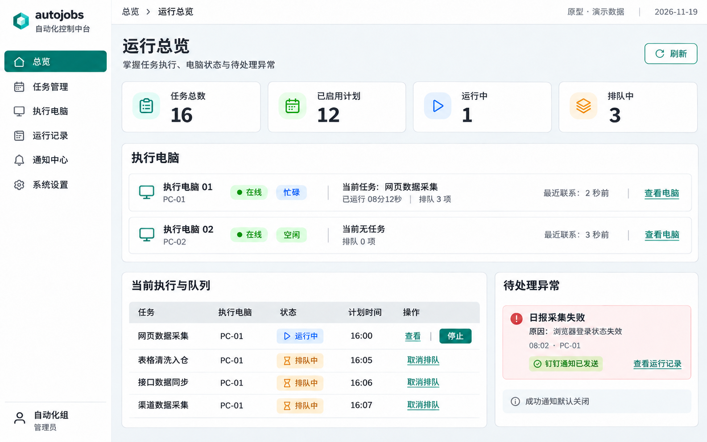
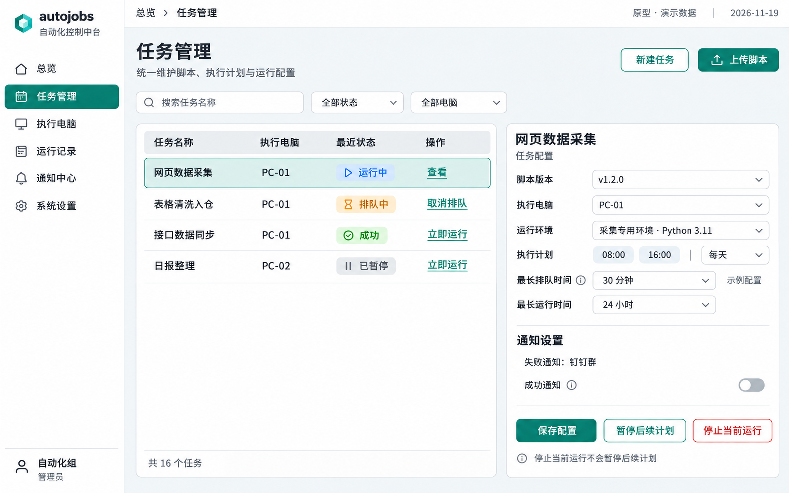
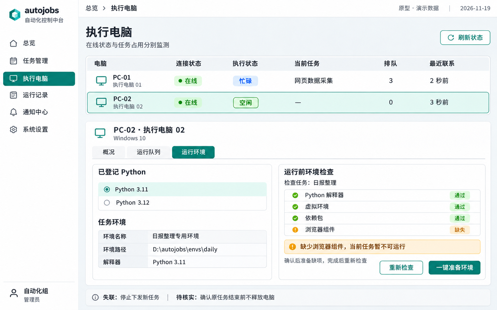
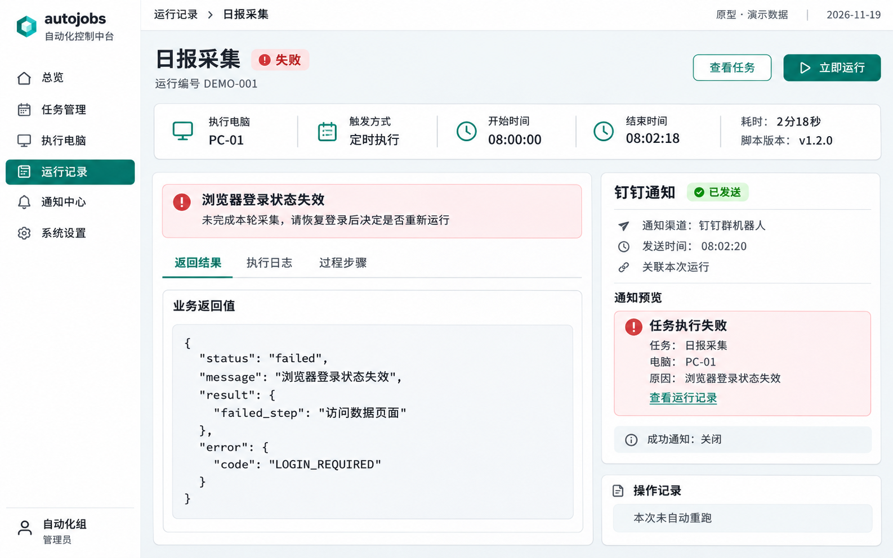
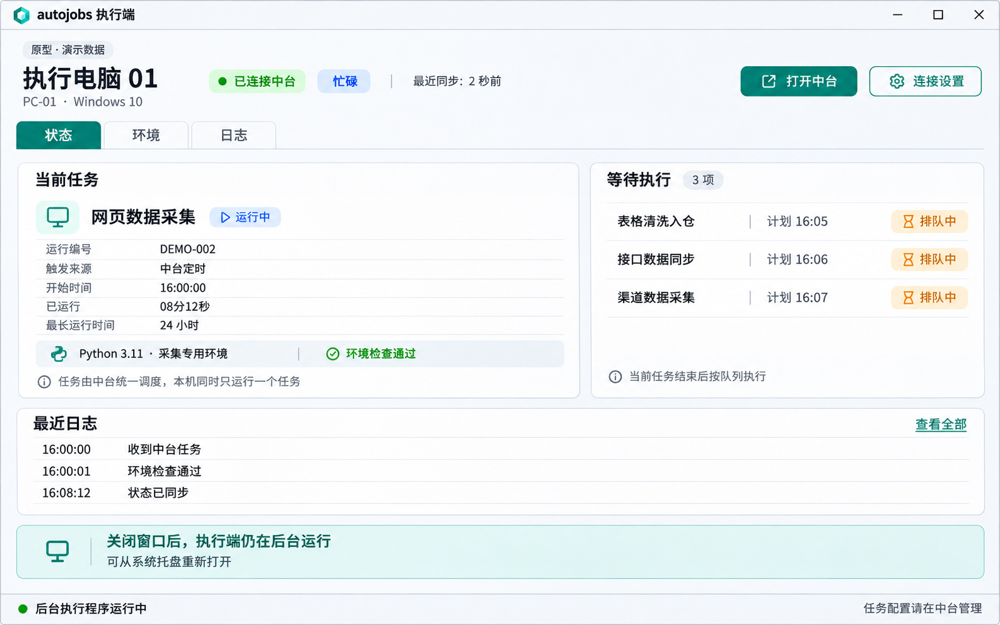

# 自动化中台主要页面视觉原型

版本：0.1。日期：2026-11-19。依据：[产品需求文档](../../automation-control-platform-prd.md)。

现有四张中台网页原型和一张执行电脑本地窗口原型，用于讨论页面布局、信息层级和操作入口；不代表已实现的软件。图内任务名、数量、时间、路径、版本和运行结果全部为演示数据。

## 原型图

五张图展示不同功能场景，不是同一时刻的实时监控快照。

### 1 总览

查看任务数量、正在运行和排队的任务、电脑在线与忙闲状态，以及需要处理的异常。

### 2 任务管理

左侧查看任务，右侧配置脚本版本、执行电脑、环境、计划时间、两类超时和成功通知开关。上传入口用于脚本包，不是每轮运行的业务输入文件。

### 3 执行电脑与环境检查

在线状态与执行占用分开显示。示例中 PC-02 在线且空闲，但“日报整理”所需浏览器组件缺失，需要点击准备并复检后才能运行。

### 4 运行详情与钉钉告警

保留脚本失败返回值，展示运行时间和电脑，并单独展示钉钉发送状态。“通知已发送”不能代替任务成功。

### 5 执行电脑本地执行端

执行电脑上的状态窗口，展示中台连接、当前任务、队列、环境和日志。建议关闭窗口时收起到托盘，后台执行程序继续运行；任务仍在网页中台统一管理。详细边界见 [本地执行端设计](local-runner.md)。

## 页面设计与验收计划

| 页面 | 需要体现的需求 | 检查要点 |
| --- | --- | --- |
| 总览 | 任务数、执行情况、电脑在线和忙闲、排队及异常 | 两台电脑；同机最多一个运行任务；无虚构真实结果 |
| 任务管理 | 上传脚本、计划、绑定电脑、超时及通知设置 | 运行上限 24 小时；成功通知关闭；排队 30 分钟仅为示例配置 |
| 执行电脑 | 连接状态与任务占用分离；环境缺项及一键准备 | 在线空闲不代表任务环境就绪；准备需主动点击 |
| 运行详情 | 脚本失败返回值、中台记录、钉钉发送结果 | 任务失败和通知已发送是不同状态；不出现凭据 |
| 本地执行端 | 常驻执行程序与可关闭状态窗口 | 关闭窗口不等于退出程序；无第二套调度入口 |

## 视觉约定

浅色工作区、白色导航与内容面板、深青色主操作；状态使用颜色加文字，避免只靠颜色判断。导航统一为总览、任务管理、执行电脑、运行记录、通知中心、系统设置。步骤进度可选，不展示强制百分比。

排队时长、示例版本等图中数值不是新增的产品默认规则。实际行为以 PRD 的已确认需求为准；图片中的控件尚不可点击。

## 制作与验证边界

使用内置图片生成工具，提示词已保存在 `prompts/`。生成后逐张检查布局、主要文案和业务状态，图片保存到本目录。图片文字不作为可执行接口定义；运行详情中的 JSON 仅为界面摘要。

完整生成提示词：[总览](prompts/01-overview.txt)、[任务管理](prompts/02-tasks.txt)、[执行电脑](prompts/03-computers.txt)、[运行详情](prompts/04-run-detail.txt)、[总览文字校正](prompts/01-overview-v2-edit.txt)。后三个页面参考初版总览的视觉样式生成；`01-overview.png` 保留为风格参考，交付选用校正后的 `01-overview-v2.png`。

补充的 [本地执行端提示词](prompts/05-local-runner.txt) 以最终总览为风格参考，通过同一内置图片生成工具生成。

## 检查记录

已目视检查四张最终图片：导航、配色、中文主要文案、24 小时运行上限、成功通知关闭、单机串行、在线/空闲/环境就绪的区分及失败告警信息符合本轮原型范围。已将总览队列中的一个演示任务更名为“渠道数据采集”，避免与 PC-02 上的“日报整理”出现跨页绑定冲突。

文件检查实际结果：通过 Python 标准库读取四张 PNG 的尺寸并验证全部图片块 CRC，同时检查相关文档的 46 个本地链接，错误 0、退出码 0。四张交付图约为 1586×992 像素；精确尺寸、字节数及 SHA-256 保存在 `manifest.json`。模板工具和业务实现未变化，不重复运行原模板单元测试。

后续还需制作并验证电脑失联、停止中、停止失败、排队超时等具体交互状态。本轮图片只有入口和文字提示，不算这些状态的交互验收。图片内文字仍应在正式页面开发时改为可维护、可选择的真实文本。

本地执行端补图已目视检查：Windows 窗口、连接/忙碌分离、单机单任务、队列、24 小时运行上限、关闭窗口后后台运行提示均清晰显示。新增文件校验见本地执行端设计页，原四张交付图片未修改。

本轮为 L1 视觉文档制作，不修改业务代码或依赖，不接入执行电脑、云服务器或钉钉。验证范围为图片可读取、页面覆盖与视觉检查；产品功能和 UI 自动化未执行。

Codex 自检只覆盖本次视觉交付，不等于开发自测确认、人工代码评审、CI 验证或发布审批通过。

AI 自检结论：通过（静态图片原型范围）。下一门禁：页面布局与信息层级评审；交互原型和正式页面开发另行安排。
