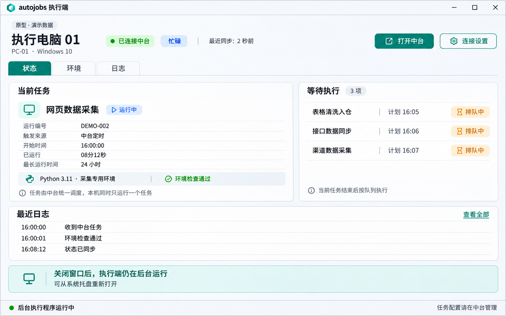

# 执行电脑本地执行端设计

日期：2026-11-19。状态：视觉与交互建议，尚未实现。

本页回答执行电脑上有什么程序、打开后看到什么。云端中台负责统一任务配置和调度；每台执行电脑运行本地执行端，接收任务并执行脚本、回传连接状态、占用状态、日志和结果。

图中为演示状态，不是已安装的软件。图片和 [完整提示词](prompts/05-local-runner.txt) 均已保存至项目。

## 建议的两部分职责

| 部分 | 职责 |
| --- | --- |
| 常驻执行程序 | 连接中台、报告状态、接收已登记任务、检查和准备环境、执行与停止控制、保留结果并回传 |
| 本地状态窗口 | 查看连接、忙闲、当前任务、队列、所用环境及日志，打开中台或连接设置 |

窗口是否显示不应决定任务是否运行。建议关闭窗口时收起到系统托盘，执行程序继续工作；托盘可以重新打开状态窗口。真正退出执行端是独立操作，运行中应提示影响并阻止误退出，具体行为在执行端设计时确认。

本机不维护第二套定时计划，不增加任意远程命令或本地脚本管理入口。环境准备仍由中台中明确的操作触发，本地窗口主要用于观察和排查。

## 启动与恢复边界

建议提供随用户登录启动及异常恢复机制，具体启动方式尚未确定，不把“后台常驻”直接等同于 Windows 系统服务。电脑关机或休眠、执行端停止时不能继续承诺执行任务，中台应按失联规则识别。

浏览器或桌面应用任务的锁屏、注销、重启和桌面会话要求，需要用实际脚本验证；不因窗口最小化即可继续运行，就推断锁屏或注销也能执行。心跳间隔及失联阈值仍按 PRD 待确认事项处理。

## 本次验证计划

- 视觉上明确本地 Windows 窗口，保留与中台一致的品牌和配色。
- 在线连接和执行占用分开；单机一个运行任务，其他任务排队。
- 清楚展示关闭窗口与后台程序运行的关系；不出现第二套调度入口。
- 图片、提示词保存到项目，验证文件完整性和本地引用。

本轮为 L1 视觉文档制作，不修改业务代码、系统启动项或运行环境。自启动、后台常驻和窗口交互均为设计建议，产品功能测试未执行。

## 检查结果

新增图片为 1586×992 像素，已通过 PNG 文件及逐块 CRC 检查；相关文档 32 个本地链接有效，错误 0、检查退出码 0。原四张交付图的 SHA-256 均与原清单一致。五张最终图片记录在 `manifest.json`。

已目视确认：本机窗口与中台网页区分清楚，连接状态和忙碌状态分开，只有一个运行任务，等待队列与 24 小时上限可见，关闭窗口后后台继续运行的建议清晰显示。AI 自检通过仅限静态视觉交付；下一门禁为本机交互和启动恢复方式评审。

Codex 自检通过不等于开发自测确认、人工代码评审、CI 验证或发布审批通过。
